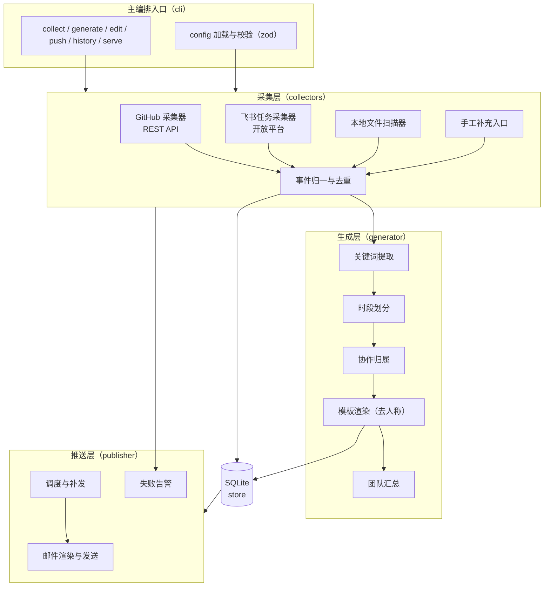
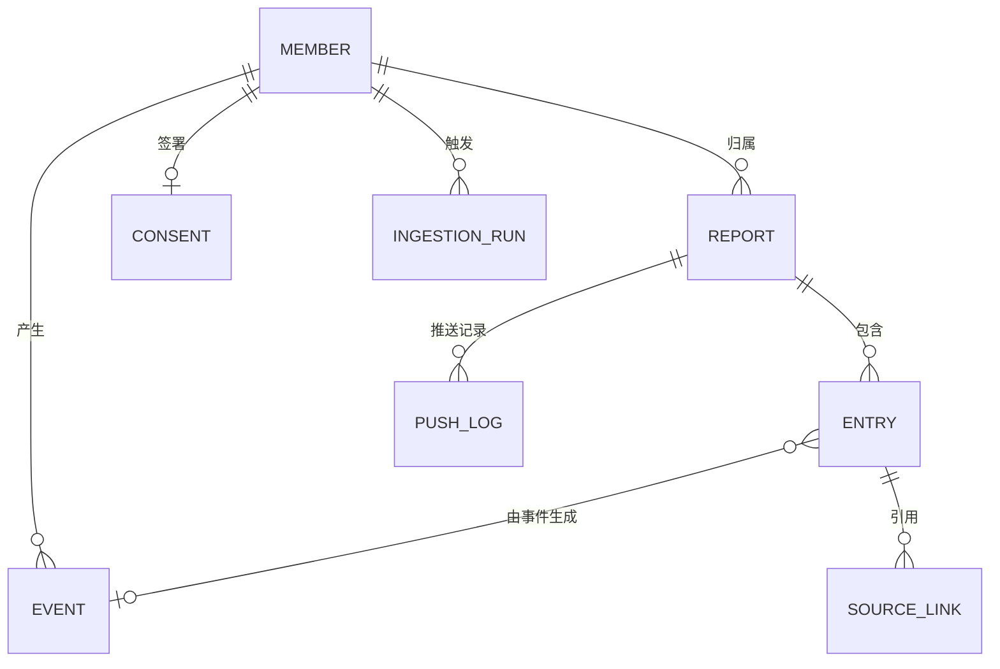

# design.md — 智能日报生成器

> 元信息
>
> | 项 | 内容 |
> |---|---|
> | 文档版本 | v0.3（实现语言改为 TypeScript，待第 2 周阶段评审） |
> | 上游规范 | `specs/proposal.md` v0.3（§3.2 访谈结论、§5 技术约束、§8 风险 R1～R6） |
> | 下游规范 | `specs/tasks.md` |
> | 编写角色 | 架构师（〔待填〕） |
> | 评审状态 | 未评审 |
> | 更新日期 | 〔待填〕 |
>
> **v0.3 变更摘要**：实现语言由 Python 改为 TypeScript。架构分层、数据模型、接口语义、ADR 决策意图与验收标准全部保持不变，仅替换语言生态相关实现（HTTP 客户端、SQLite 驱动、测试框架、静态检查工具）。所有 ADR 的"被否决备选项"已按新生态重新评估，未沿用原结论。

---

## 1. 系统架构

### 1.1 分层结构

系统按 **采集层 → 生成层 → 推送层** 三层构建，外层由 **主编排入口（CLI）** 串联。层间只通过类型定义与函数契约通信，不允许跨层直接调用。



### 1.2 分层职责与依赖方向

| 层 | 职责 | 允许依赖 | 明确禁止 |
|---|---|---|---|
| 主编排入口 `cli` | 解析命令与参数、加载配置、按序调用各层、聚合退出码 | 全部层 | 不含业务规则 |
| 采集层 `collectors` | 从外部源拉取原始数据并归一为 `Event`，负责去重与失败分类 | 外部 API（经 `http.ts`）、`store`（写入） | 不生成日报文本、不做归属判断 |
| 生成层 `generator` | 从 `Event` 生成 `Entry` 与 `Report`，负责时段、状态、语体、归属、汇总 | `store`、`config` | **不得 import 采集层，不得发起网络请求**（纯计算，便于测试） |
| 推送层 `publisher` | 渲染邮件正文、发送、调度与补发、失败告警 | `store`、SMTP | 不修改日报内容 |
| 存储 `store` | 全部持久化读写，屏蔽 SQL 细节 | `better-sqlite3` | 不含业务判断（如"哪些条目算同一条"） |

> 依赖方向的硬约束：生成层必须可在无网络环境下以固定输入完成测试（对应指导书 TDD 要求），因此外部请求一律收敛在采集层的 `http.ts`。ESLint 以 `no-restricted-imports` 把该约束变成机器可检查的规则，而非口头约定。

### 1.3 关键数据流（一次完整生成）

1. `sdr collect` 触发三个采集器并行拉取（`Promise.allSettled`）→ 各自写入 `event` 表（含 `dedupeKey`）
2. `sdr generate` 读当日 `event` → 关键词提取 → 时段归位 → 归属判定 → 模板渲染 → 单事务写入 `report` + `entry` + `source_link`
3. `sdr push` 读当日 `report` → 渲染邮件 → SMTP 发送 → 写 `push_log`
4. `sdr serve` 由调度器在配置时点执行上述三步；错过时点由补发任务在下次启动时检测并执行

---

## 2. 模块职责（一句话边界）

| 模块 | 路径 | 一句话职责 |
|---|---|---|
| `http` | `src/sdr/http.ts` | 封装 `fetch`，统一超时、重试、退避与日志掩码，是全系统唯一的外部请求出口 |
| `collectors.github` | `src/sdr/collectors/github.ts` | 拉取指定仓库在统计窗口内的提交并归一为 `Event` |
| `collectors.feishu` | `src/sdr/collectors/feishu.ts` | 拉取任务流转记录并归一为 `Event` |
| `collectors.local` | `src/sdr/collectors/local.ts` | 按 `mtime` 扫描配置目录，识别当日产出文件 |
| `collectors.manual` | `src/sdr/collectors/manual.ts` | 接收命令行录入的条目并转为 `Event`（`source='manual'`） |
| `collectors.normalize` | `src/sdr/collectors/normalize.ts` | 生成 `dedupeKey`、合并多源同一事件、确定主源标记 |
| `generator.extract` | `src/sdr/generator/extract.ts` | 按关键词库识别进展阶段，输出 `phase` 与命中置信度 |
| `generator.timeline` | `src/sdr/generator/timeline.ts` | 按休息时段将事件归入时间块 |
| `generator.attribution` | `src/sdr/generator/attribution.ts` | 依据 `Co-authored-by` 与兜底规则确定协作归属 |
| `generator.render` | `src/sdr/generator/render.ts` | 以去人称模板渲染条目与日报正文 |
| `generator.summary` | `src/sdr/generator/summary.ts` | 将多人日报聚合为团队日报（仅聚合，不展开他人明细） |
| `publisher.mail` | `src/sdr/publisher/mail.ts` | 经 `nodemailer` 渲染并发送 MIME 邮件，返回发送结果 |
| `publisher.scheduler` | `src/sdr/publisher/scheduler.ts` | 按配置时点触发推送，检测并执行补发 |
| `publisher.alert` | `src/sdr/publisher/alert.ts` | 采集或推送失败时发送告警邮件 |
| `store.repo` | `src/sdr/store/repo.ts` | 提供 `Event` / `Report` / `Entry` 的读写接口，屏蔽 SQL |
| `store.schema` | `src/sdr/store/schema.ts` | 建表、PRAGMA 设置与约束校验 |
| `config` | `src/sdr/config.ts` | 从环境变量与 YAML 加载并以 zod 校验全部设置项 |
| `errors` | `src/sdr/errors.ts` | 定义 `SdrError` 与错误码，统一错误分类 |

> 共 18 个模块。`errors.ts` 与 `http.ts` 是横切模块，除 CLI 外各层均可依赖，但反向依赖禁止（`http` 不得依赖任何业务模块）。

---

## 3. 数据模型

### 3.1 ER 图



### 3.2 表结构

SQLite 采用 `snake_case` 列名（数据库惯例），TypeScript 侧由 `store/repo.ts` 映射为 `camelCase` 属性，映射函数集中在同一文件，避免散落。

**member**

| 字段 | 类型 | 约束 | 说明 |
|---|---|---|---|
| `id` | INTEGER | PK AUTOINCREMENT | 主键 |
| `github_login` | TEXT | UNIQUE NOT NULL | GitHub 用户名，采集匹配键 |
| `feishu_open_id` | TEXT | UNIQUE NULL | 飞书用户 ID，未接入时为空 |
| `display_name` | TEXT | NOT NULL | 日报中的姓名 |
| `manager_id` | INTEGER | FK → member.id NULL | 直属上级，决定可见性 |
| `active` | INTEGER | NOT NULL DEFAULT 1 | 是否在职（0/1） |
| `created_at` | TEXT | NOT NULL | ISO 8601 |

**event**

| 字段 | 类型 | 约束 | 说明 |
|---|---|---|---|
| `id` | INTEGER | PK | 主键 |
| `member_id` | INTEGER | FK → member.id NOT NULL | 事件归属人 |
| `source` | TEXT | NOT NULL CHECK IN ('github','feishu','local','manual') | 来源 |
| `source_id` | TEXT | NOT NULL | 源侧唯一标识（commit sha / task id / 文件路径+mtime） |
| `kind` | TEXT | NOT NULL | 事件类型（commit / task_done / file_change / note） |
| `occurred_at` | TEXT | NOT NULL | 发生时间，用于时段归位 |
| `title` | TEXT | NOT NULL | 短标题，进正文字段 |
| `detail` | TEXT | NULL | 补充说明（提交信息正文等） |
| `dedupe_key` | TEXT | UNIQUE NOT NULL | 去重键：`sha1(source_id + 日期 + member_id)` 或归一后的业务键 |
| `is_primary` | INTEGER | NOT NULL DEFAULT 0 | 是否主源事件（1=主源 0=辅助） |
| `payload` | TEXT | NULL | 原始 JSON，便于追溯 |
| `created_at` | TEXT | NOT NULL | 入库时间 |

**report**

| 字段 | 类型 | 约束 | 说明 |
|---|---|---|---|
| `id` | INTEGER | PK | 主键 |
| `member_id` | INTEGER | FK → member.id NOT NULL | 归属人 |
| `report_date` | TEXT | NOT NULL | 日期（YYYY-MM-DD） |
| `status` | TEXT | NOT NULL CHECK IN ('draft','confirmed','leave','blank') | 状态，`leave` 与 `blank` 语义不同 |
| `body` | TEXT | NULL | 渲染后的邮件正文 |
| `generated_at` | TEXT | NOT NULL | 生成时间 |
| `pushed_at` | TEXT | NULL | 推送时间 |
| — | — | UNIQUE(member_id, report_date) | 一人一日一份 |

**entry**

| 字段 | 类型 | 约束 | 说明 |
|---|---|---|---|
| `id` | INTEGER | PK | 主键 |
| `report_id` | INTEGER | FK → report.id NOT NULL | 所属日报 |
| `time_block` | TEXT | NOT NULL | 时段标识（morning / afternoon / evening / 自定义） |
| `state` | TEXT | NOT NULL CHECK IN ('done','doing','plan','blocked') | 状态分类 |
| `content` | TEXT | NOT NULL | 去人称陈述 |
| `order_index` | INTEGER | NOT NULL | 同时段内排序 |
| `source_event_id` | INTEGER | FK → event.id NULL | 由哪条事件生成；手工条目为空 |
| `is_manual` | INTEGER | NOT NULL DEFAULT 0 | 是否手工补充 |

**source_link**

| 字段 | 类型 | 约束 | 说明 |
|---|---|---|---|
| `id` | INTEGER | PK | 主键 |
| `entry_id` | INTEGER | FK → entry.id NOT NULL | 所属条目 |
| `link_type` | TEXT | NOT NULL CHECK IN ('url','path') | 链接形态 |
| `target` | TEXT | NOT NULL | 提交地址或文件路径 |

**ingestion_run / push_log / consent**（审计与合规）

| 表 | 关键字段 | 用途 |
|---|---|---|
| `ingestion_run` | `source`, `started_at`, `finished_at`, `result`(ok/partial/failed), `error_code`, `error_msg` | 每次采集留痕，支撑"失败标注原因"（CS-07） |
| `push_log` | `report_date`, `channel`, `sent_at`, `result`, `retry_count` | 推送与补发留痕（CS-08） |
| `consent` | `member_id`, `agreed_at`, `scope` | 成员知情同意记录，合规证据 |

### 3.3 关键约束说明

1. `dedupe_key` 唯一约束是去重准确率 100%（CS-01）的实现基础；`store/repo.ts` 捕获 `SQLITE_CONSTRAINT_UNIQUE` 并转换为幂等成功，而非向上抛错——重复采集应是"已存在"，不是"失败"。
2. `report.status` 的四个取值互斥，`leave`（未出勤）与 `blank`（出勤无进展）不可混用（对应 IR-01）。
3. 归属关系不落独立表，而由 `entry.source_event_id → event.member_id` 与 `source_link` 组合表达：一条条目只能指向一个事件，但一个事件可被多条条目引用。
4. 日报正文同时存于 `report.body`（快照）与 `entry` 行（结构化）；编辑以 `entry` 为准，推送前重新渲染 `body`，避免两处不一致。
5. 数据库启用 `PRAGMA journal_mode=WAL` 与 `PRAGMA foreign_keys=ON`，前者保证读写不互锁，后者保证外键约束真实生效（SQLite 默认关闭外键）。

---

## 4. 接口契约

### 4.1 核心类型（`src/sdr/types.ts`）

```ts
export type Source = 'github' | 'feishu' | 'local' | 'manual';
export type Phase = 'done' | 'doing' | 'plan' | 'blocked';
export type ReportStatus = 'draft' | 'confirmed' | 'leave' | 'blank';

export interface Event {
  readonly id?: number;
  readonly memberId: number;
  readonly source: Source;
  readonly sourceId: string;
  readonly kind: 'commit' | 'task_done' | 'file_change' | 'note';
  readonly occurredAt: Date;
  readonly title: string;
  readonly detail?: string;
  readonly dedupeKey: string;
  readonly isPrimary: boolean;
  readonly payload?: unknown;
}

export interface Entry {
  readonly id?: number;
  readonly reportId: number;
  readonly timeBlock: string;
  readonly state: Phase;
  readonly content: string;
  readonly orderIndex: number;
  readonly sourceEventId?: number;
  readonly isManual: boolean;
}

export interface SourceLink {
  readonly entryId: number;
  readonly linkType: 'url' | 'path';
  readonly target: string;
}
```

> 类型字段全部 `readonly`：条目一旦生成即不应被就地修改，编辑走"新建条目 + 删除旧条目"，使变更可追溯。

### 4.2 CLI 命令

| 命令 | 入参 | 出参 / 退出码 | 行为约束 |
|---|---|---|---|
| `sdr collect` | `--date`（默认今日）、`--source`（可重复，缺省全部）、`--manual` | 0=全部成功、3=部分失败、4=全部失败 | 单源失败不影响其他源（`allSettled`）；每次执行写一条 `ingestion_run` |
| `sdr generate` | `--date`、`--member`（缺省全部在册成员）、`--force` | 0=成功（无可生成数据时输出空白模板仍为 0） | 已存在 `confirmed` 日报不覆盖，除非 `--force` |
| `sdr edit` | `--date`、`--member`、`--add-text`、`--remove-entry`、`--accept-attribution` | 0=成功、6=条目不存在 | 编辑后 `status` 置回 `draft`；`--accept-attribution` 用于确认 `[待确认]` 归属 |
| `sdr push` | `--date`、`--dry-run` | 0=成功、7=发送失败（已告警） | `--dry-run` 只渲染不发送，正文写到 stdout |
| `sdr history` | `--member`、`--from`、`--to` | 0=成功、8=无权访问 | 校验调用者身份（本人或直属上级），否则拒绝（CS-09） |
| `sdr serve` | 无 | 常驻进程 | 启动调度器，按配置时点推送并处理补发 |

统一退出码：`0` 成功、`2` 参数错误（commander 抛出）、`3` 部分失败、`4` 采集全失败、`5` 无数据、`6` 条目不存在、`7` 推送失败、`8` 权限拒绝、`9` 配置非法。

### 4.3 模块函数契约（节选核心）

```ts
// collectors/github.ts
export interface GithubCollectOptions {
  repo: string;   // 形如 "owner/name"
  since: Date;    // 左闭
  until: Date;    // 右开
  token: string;
}
export function collectGithub(opts: GithubCollectOptions): Promise<Event[]>;

// collectors/normalize.ts
export function dedupe(events: readonly Event[]): Event[];

// generator/extract.ts
export interface KeywordRule { pattern: RegExp; phase: Phase; weight: number }
export function extractPhase(
  text: string,
  rules: readonly KeywordRule[],
): { phase: Phase; confidence: number };

// generator/timeline.ts
export interface WorkBlock { name: string; start: string; end: string } // "09:00"
export function assignBlocks(
  events: readonly Event[],
  blocks: readonly WorkBlock[],
): Map<string, Event[]>;

// generator/attribution.ts
export interface AttributionResult { members: number[]; pending: boolean }
export function resolveAttribution(event: Event, repoIndex: RepoIndex): AttributionResult;

// generator/render.ts
export function renderEntry(
  event: Event,
  phase: Phase,
  links: readonly SourceLink[],
): string;

// publisher/mail.ts
export interface MailPayload { to: string[]; subject: string; text: string; html: string }
export function sendMail(payload: MailPayload): Promise<{ ok: true; messageId: string }>;
```

| 函数 | 入参约束 | 错误码 | 行为约束 |
|---|---|---|---|
| `collectGithub` | `repo` 匹配 `^[\w.-]+/[\w.-]+$`；`since < until` | `SDR-E101` 令牌失效、`SDR-E102` 速率限制、`SDR-E103` 网络超时 | 超时重试 ≤ 3 次（1/2/4 秒退避）；仍失败抛出，**不返回部分结果** |
| `collectFeishu` | 同上 | `SDR-E201` 授权失败、`SDR-E202` 字段缺失 | 状态映射固定（完成→done），未知状态归 `doing` |
| `dedupe` | 输入可含重复 | — | 同一 `dedupeKey` 仅保留 `isPrimary` 或最早入库者；结果按 `occurredAt` 升序 |
| `extractPhase` | `text.trim()` 非空 | — | 无命中返回 `{ phase: 'doing', confidence: 0 }`，不猜测 |
| `assignBlocks` | 时段互不重叠、按起点升序 | `SDR-E301` 配置时段重叠 | 落在休息区间的事件归入前一工作时段（IR-05）；跨时段事件只按开始时间归位一次 |
| `resolveAttribution` | — | — | 有 `Co-authored-by` 时全部采纳；无标记按 ADR-004 兜底，兜底失败归提交作者并置 `pending=true` |
| `renderEntry` | — | `SDR-E302` 来源链接为空 | 输出不含第一人称代词（CS-05）；单句 ≤ 60 字；`links` 为空时抛错（维护 CS-04） |
| `sendMail` | 收件人非空 | `SDR-E401` 认证失败、`SDR-E402` 连接超时 | 失败抛出，由 `alert` 记录并告警；自身不重试（补发由 `scheduler` 负责） |

### 4.4 错误码表

| 码段 | 类别 | 处理策略 |
|---|---|---|
| `SDR-E1xx` | GitHub 采集 | 记录 `ingestion_run`，标注原因并告警，其余源继续 |
| `SDR-E2xx` | 飞书采集 | 同上 |
| `SDR-E3xx` | 配置与生成约束 | 启动或生成阶段失败，退出码 9，不产生半成品 |
| `SDR-E4xx` | 推送 | 记录 `push_log`，告警，进入补发队列 |
| `SDR-E5xx` | 存储 | 事务回滚后抛出，不落不完整数据 |

实现约定：`errors.ts` 导出 `SdrError` 类（含 `code`、`source`、`cause`），禁止抛裸 `Error`；由 ESLint 的 `no-throw-literal` 与自定义规则共同约束。

---

## 5. 技术选型 ADR

### 5.0 ADR 索引与追溯

| ADR | 主题 | 状态 | 解决的上游项 | 落地模块 |
|---|---|---|---|---|
| ADR-001 | 运行时、包管理与 HTTP 访问 | 已接受 | 提案 §5 技术约束（语言/外部依赖） | `http.ts`、`cli.ts` |
| ADR-002 | 存储方案与驱动 | 已接受 | §8 R2、CS-01、CS-10 | `store/schema.ts`、`store/repo.ts` |
| ADR-003 | 生成策略与模板形态 | 已接受 | EX-04（排除生成式）、CS-04 | `generator/render.ts` |
| ADR-004 | 归属规则与兜底 | 已接受 | **§8 R3**（高）、G-03、CS-03 | `generator/attribution.ts` |
| ADR-005 | 时段划分与配置格式 | 已接受 | 提案 §5.1 待决策 3、IR-05 | `generator/timeline.ts`、`config.ts` |
| ADR-006 | 汇总可见性与粒度 | 已接受 | **§8 R6**（高）、IR-07、CS-09 | `generator/summary.ts` |

> 未被 ADR 覆盖的上游项：R1（群聊采集）已由提案 EX-01、EX-02 排除，无需设计决策；R4（可解释性）由 CS-04 的来源链接要求承接；R5（状态语义）落在 §3.2 的 `report.status` 约束中。

### ADR-001 运行时、包管理与 HTTP 访问

| 项 | 内容 |
|---|---|
| 状态 | 已接受（**v0.3 重新评估**，原 Python + httpx 方案作废） |
| 背景 | 语言改为 TypeScript 后，需重新选择运行时、依赖管理方式与 HTTP 访问方案；要求可测试（无网络打桩）、可设超时与重试、不引入额外运行时概念 |

| 备选项 | 评估 | 结论 |
|---|---|---|
| Node.js 22 LTS + 内置 `fetch` + `undici` `MockAgent` | `fetch` 是运行时能力，零依赖；`MockAgent` 在进程内拦截请求，测试无需真实网络 | **采纳** |
| Node.js + `axios` + `nock` | 生态成熟；但 axios 自带适配器与拦截器抽象，与"单一请求出口"原则重复；`nock` 依赖 HTTP 层补丁，Node 升级时兼容性偶发问题 | 否决：两套抽象叠加，打桩脆弱 |
| `@octokit/rest` 直连 GitHub | 自动处理分页与限流；但飞书无等价封装，系统仍需通用 HTTP 层，等于两套请求路径 | 否决：请求出口不唯一，违反 §1.2 约束 |
| Bun 运行时 | 启动快、内置 SQLite 与测试框架；但与课程环境（Node LTS）不一致，指导教师复现成本高 | 否决：可复现性优先于性能 |

**决策**：Node.js ≥ 22 LTS，`pnpm` 管理依赖，TypeScript 5.x（`strict`），HTTP 统一走 `src/sdr/http.ts`（基于内置 `fetch` + `AbortSignal.timeout`，重试用 `p-retry` 或手写指数退避）。测试用 `vitest` + `undici` `MockAgent` 注入假响应。

**理由**：`fetch` 是运行时能力而非依赖，减少一个供应链风险点；`MockAgent` 使采集层与生成层同样可离线测试，这是 TDD 红绿循环的前提。`pnpm` 的严格依赖解析可暴露未声明的 import，对 AI 生成代码尤其重要。

**后果**：分页需手写（GitHub 每页 100 条，最多取 10 页）；后续若需速率限制感知，可增加薄封装而不改动调用方签名。

---

### ADR-002 存储方案与驱动

| 项 | 内容 |
|---|---|
| 状态 | 已接受（**v0.3 重新评估**） |
| 背景 | 需持久化日报历史（永久保留）、支撑按人按日查询（CS-10），且为单机 CLI 工具；语言为 TypeScript |

| 备选项 | 评估 | 结论 |
|---|---|---|
| `better-sqlite3` | 同步 API、性能好，事务与唯一约束原生支持；预编译二进制，安装顺畅 | **采纳** |
| `node:sqlite`（Node 内置） | 零依赖；但 Node 22 中为实验特性，API 不稳定且缺类型定义，`strict` 下需手写声明 | 否决：稳定性与类型体验不达标 |
| `drizzle-orm` / `prisma` | 类型安全的查询构建；但为 8 张表的单机工具引入 ORM 与生成步骤，评审解释成本高 | 否决：过度设计（与原否决 PostgreSQL 同理） |
| 纯 JSON 文件 | 零依赖、易人工查看；去重需全量加载，唯一性无法由存储层保证 | 否决：CS-01 无实现基础 |

**决策**：`better-sqlite3`，数据库文件位于 `data/sdr.db`（`.gitignore` 已排除），通过 `store/repo.ts` 单点访问，禁止其他模块 import 该驱动（ESLint `no-restricted-imports` 强制）。

**理由**：同步 API 使事务边界清晰（`db.transaction(fn)` 一次调用完成"日报 + 条目 + 来源链接"原子写入），比异步驱动的 `await` 链更不易出现部分提交；配合自写 repository 类型，可将行记录映射为 §4.1 的领域类型。

**后果**：行记录与领域对象的映射代码需手写（约 80 行），换来零 ORM 依赖；原生模块在跨平台安装时可能需构建工具，README 须注明前置条件。

---

### ADR-003 生成策略与模板形态

| 项 | 内容 |
|---|---|
| 状态 | 已接受（**v0.3 重新评估**） |
| 背景 | 需从事件生成去人称、分时段的条目，每条可追溯到来源（IR-06） |

| 备选项 | 评估 | 结论 |
|---|---|---|
| TS 纯函数模板（`renderEntry` 直接返回字符串） | 类型安全、可快照断言、来源一一对应；改措辞需改代码 | **采纳** |
| `handlebars` / `ejs` 模板文件 | 措辞可外置、非程序员可改；但模板语法无类型检查，字段名拼错仅运行时暴露 | 否决：与 `strict` 的类型保护目标相反 |
| LLM 生成措辞 | 表达自然；同输入多次输出不同，单测无法断言，来源追溯断裂 | 否决：违反 CS-04 与可测试性，且属提案 EX-04 排除项 |
| 模板函数 + LLM 润色（可开关） | 兼顾两者；开关使测试矩阵翻倍 | 否决：v1.1 再议 |

**决策**：全部由纯函数模板生成，措辞以具名常量集中存放于 `src/sdr/generator/phrases.ts`，去人称通过固定句式 + 代词黑名单双重保证。

**理由**：纯函数无副作用，输入相同则输出相同，可直接写快照测试；类型系统保证字段不会被拼错。

**后果**：语言较机械，接受该代价；措辞调整属代码变更，须走 code review。

---

### ADR-004 协作归属规则与兜底策略

| 项 | 内容 |
|---|---|
| 状态 | 已接受（对应提案 §8 R3，高等级风险） |
| 背景 | 仅依赖 `Co-authored-by` 标记时，实际团队中该标记出现率偏低，大量协作成果将无归属 |

| 备选项 | 评估 | 结论 |
|---|---|---|
| 仅 `Co-authored-by` | 规则最简、有标记时 100% 准确 | 否决：覆盖率不足，G-03 无法达成 |
| 同一文件路径历史作者（近 30 天） | 覆盖广；会把"长期共同维护同一文件"的无关人员牵连进来 | 否决：误归率高，损害信任 |
| 时间窗重叠（同一任务 24 小时内均有人操作） | 与飞书任务联动，语义较准 | **采纳为一级兜底** |
| 人工认领 | 最准确；纯人工等于回到手工填日报 | 采纳为**二级兜底**：`sdr edit --accept-attribution` |

**决策**：三级策略——① 有 `Co-authored-by` 则严格按标记归属（CS-03 命中 100%）；② 无标记但存在同一任务的多人流转记录，则归属该任务全部操作者，条目末尾标注"（协作）"；③ 仍无法判定时归提交作者，条目加 `[待确认]` 前缀并置 `pending=true`，由成员 `sdr edit --accept-attribution` 确认。

**理由**：把不确定性显式化，而非用概率算法掩盖。宁可标"待确认"，也不做可能错误的自动分配（IR-06 信任要求）。

**后果**：日报中可能出现少量 `[待确认]` 条目，需成员一次确认；该指标纳入第 4 周质量数据（待确认条目占比）。

---

### ADR-005 时段划分与配置格式

| 项 | 内容 |
|---|---|
| 状态 | 已接受（对应提案 §5.1 待决策 3、IR-05） |
| 背景 | 条目需按工作时段归位；午休跨越会导致"上午/下午"叙事错位，不同团队作息不同；配置需被启动时校验 |

| 备选项 | 评估 | 结论 |
|---|---|---|
| 固定自然小时（09–12、13–18） | 实现最简；作息不同则全错位 | 否决 |
| 配置为 TS 模块（`config/workHours.ts`） | 类型安全、可自动补全；但改作息需改代码并重新构建，非技术成员无法维护 | 否决：违背"可配置"初衷 |
| YAML + zod 校验 | 人类可读、可热改，zod 提供运行时校验并推导类型 | **采纳** |
| TOML / JSON | 同样可读；TOML 在 Node 生态需额外依赖且类型推导弱，JSON 不支持注释 | 否决：YAML 在可读性与工具支持上更平衡 |

**决策**：`config/work-hours.yaml` 定义时段表（默认上午 09:00–12:00、下午 13:30–18:00、晚间 19:00–22:00），由 `config.ts` 用 zod 校验：时段不重叠、按起点升序、每个工作日至少一段；违反抛 `SDR-E301`。

**理由**：时段是叙事结构而非统计维度，命名权应交团队；YAML + zod 兼顾"非程序员可改"与"启动即校验"，避免运行到生成阶段才发现配置错误。

**后果**：落在休息区间的事件（如 12:30 的提交）归入前一工作时段并按发生时间排序；README 需提供配置示例与字段说明。

---

### ADR-006 团队汇总的可见性与聚合粒度

| 项 | 内容 |
|---|---|
| 状态 | 已接受（对应提案 §8 R6、IR-07，高等级风险） |
| 背景 | 日报"仅本人与直属上级可见"，但团队汇总需覆盖全组；汇总若展开明细则突破可见边界，且涉及隐私红线 |

| 备选项 | 评估 | 结论 |
|---|---|---|
| 汇总展开各成员条目正文 | 信息最全；直接违反 CS-09 与隐私红线 | 否决 |
| 汇总仅含条目计数与状态分布 | 合规；但组长难以发现阻塞 | 采纳**基础形态** |
| 计数 + 阻塞项摘要（其余明细不展开） | 合规与可用的折中：阻塞项本就是"需要支持"的信号，属组内共知信息 | **采纳** |
| 不做汇总，仅逐人邮件 | 最简单；但失去"免除组长手工汇总"目标（G-04） | 否决 |

**决策**：团队日报含三段——① 出勤与状态矩阵（正常/请假/空白）；② 每人条目数与完成/进行中/阻塞分布；③ 阻塞项汇总（仅阻塞条目正文）。汇总由 `summary.ts` 读取数据时按 `state = 'blocked'` 筛选，**不读取其他状态的 `content` 字段**——在查询层而非渲染层实现可见性边界，避免后续改模板时泄露。

**理由**：把隐私约束下沉到数据访问，比在渲染函数里"记得不要输出"更可靠；这是本 ADR 与原 Python 方案在实现要点上唯一的实质差异。

**后果**：汇总邮件收件人为组长；成员可申请查看汇总（只读）；该规则须在系统说明中明示，避免成员误解为"日报被公开"。

---

## 6. 非功能性约束

| 类别 | 约束 | 验证方式 |
|---|---|---|
| 性能 | 单成员单日生成 ≤ 30 秒（P95）；团队汇总 ≤ 60 秒；历史查询 ≤ 2 秒（≤ 1000 条） | 第 2 周实测记录，写入测试报告 |
| 性能 | 外部 API 调用 ≤ 速率限制的 50% | 代码审查 + 请求计数日志 |
| 安全 | 凭证仅经环境变量注入，代码与仓库不含任何密钥；启动时校验必需变量缺失则退出码 9 | CI 静态扫描 + 人工审查 |
| 安全 | 数据访问按 `memberId` 过滤，非本人且非直属上级的查询返回退出码 8 | 单元测试覆盖（CS-09） |
| 安全 | 日志不得输出完整令牌（超过 8 位一律掩码），由日志器的 `redact` 配置兜底 | 审查日志样例 |
| 合规 | 采集前须存在 `consent` 记录，缺失时 `collect` 拒绝执行并提示 | 集成测试 |
| 兼容 | Node.js ≥ 22 LTS；macOS 与 Linux 均可运行 | CI 双平台矩阵 |
| 可维护性 | `tsc --noEmit` 零错误（`strict: true`，禁 `any`）；ESLint + Prettier 通过 | CI 门禁 |
| 可维护性 | 关键路径函数覆盖率 ≥ 80%（`vitest run --coverage`，v8 提供者） | CI 门禁 |
| 可维护性 | 单文件 ≤ 300 行；生成层不得 import 采集层；非 `store` 模块不得 import `better-sqlite3` | ESLint `no-restricted-imports` + 文件行数检查 |
| 可观测性 | 每次采集/推送写一条审计记录；错误日志含错误码与源标识 | 日志样例审查 |
| 可观测性 | `[待确认]` 归属条目占比须可统计（ADR-004 的后果指标） | 生成报告的统计行 |

---

## 7. 待补充（第 2 周完成）

- UML 图正式版：用例图、类图、ER 图、泳道图（用绘图工具绘制，作为本文件附件，Markdown 内 mermaid 仅作草稿）
- 性能实测数据：ADR-001 中"分页与并发改进"的触发判定依据（`Promise.allSettled` 并行采集的实际收益）
- `config/work-hours.yaml` 与 `.env.example` 的字段清单定稿
- ADR-004 实测校准：`Co-authored-by` 覆盖率与 `[待确认]` 条目占比的基线数据，决定是否调整提案 G-03 的 80% 目标
- 工时校准：tasks.md 需按 TypeScript 生态重估（工具链搭建 +3 人时，`better-sqlite3` 跨平台安装预留 2 人时分缓冲）
