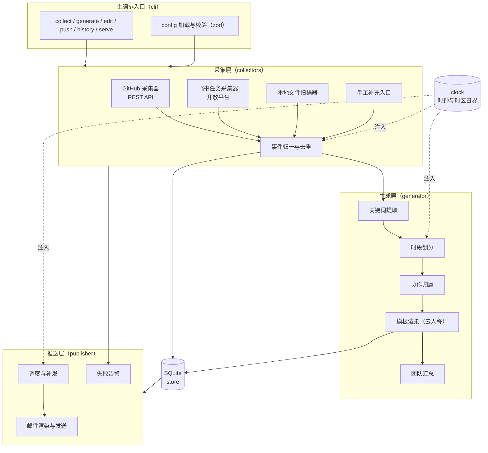
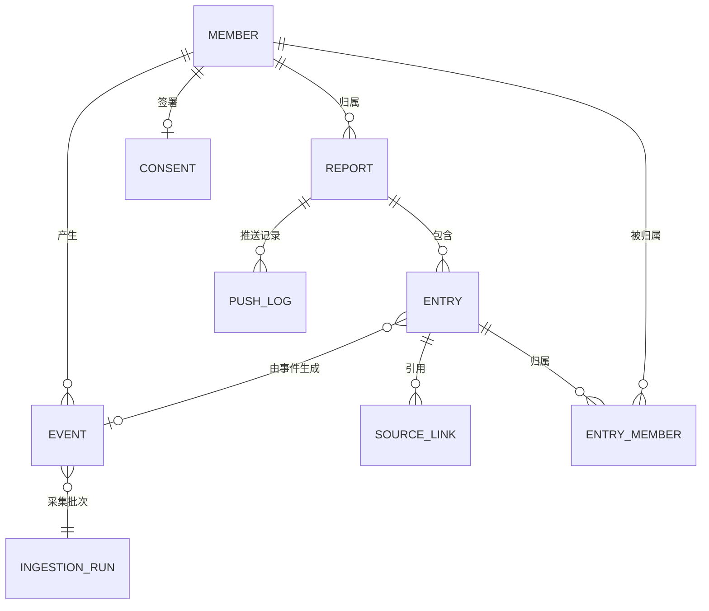

# design.md — 智能日报生成器

> 元信息
>
> | 项 | 内容 |
> |---|---|
> | 文档版本 | v0.4（按 `specs/design-review.md` 16 条缺陷修订，已全部关闭；附录 A 双轨对比与 UML 附件为第 2 周末补录） |
> | 上游规范 | `specs/proposal.md` v0.4（§3.2 访谈结论、§5 技术约束、§8 风险 R1～R6） |
> | 下游规范 | `specs/tasks.md` v0.3 |
> | 评审记录 | `specs/design-review.md`（R-01～R-16，本版逐条回应） |
> | 编写角色 | 架构师（〔待填〕） |
> | 评审状态 | 评审单 16/16 已关闭（生成方复核）；待阶段评审会由他人抽查签字 |
> | 更新日期 | 2026-11-25 |
>
> **v0.4 变更摘要**：本版为评审驱动的修订，不改架构分层，仅修复契约与数据模型的缺陷。核心三处：① 归属关系改由 `entry_member` 关联表承载，解决多作者提交无法表达的问题（R-02）；② 团队汇总改为「计数 + 定位信息」，不再读取任何条目正文，`CS-09` 无需例外（R-01）；③ 新增 `clock.ts` 统一时钟与时区日界，禁止用 UTC 日期判定「当日」（R-04、R-10）。另新增 `link_type='note'` 使手工条目可合规渲染（R-03），错误码新增 `E104`（分页上限）与 `E6xx`（生成约束）并重排退出码（R-06、R-08）。

---

## 1. 系统架构

### 1.1 分层结构

系统按 **采集层 → 生成层 → 推送层** 三层构建，外层由 **主编排入口（CLI）** 串联。层间只通过类型定义与函数契约通信，不允许跨层直接调用。



### 1.2 分层职责与依赖方向

| 层 | 职责 | 允许依赖 | 明确禁止 |
|---|---|---|---|
| 主编排入口 `cli` | 解析命令与参数、加载配置、按序调用各层、聚合退出码 | 全部层 | 不含业务规则 |
| 采集层 `collectors` | 从外部源拉取原始数据并归一为 `Event`，负责去重与失败分类 | 外部 API（经 `http.ts`）、`store`（写入）、`clock` | 不生成日报文本、不做归属判断 |
| 生成层 `generator` | 从 `Event` 生成 `Entry` 与 `Report`，负责时段、状态、语体、归属、汇总 | `store`、`config`、`clock` | **不得 import 采集层，不得发起网络请求**（纯计算，便于测试） |
| 推送层 `publisher` | 渲染邮件正文、发送、调度与补发、失败告警 | `store`、SMTP、`clock` | 不修改日报内容 |
| 存储 `store` | 全部持久化读写，屏蔽 SQL 细节 | `better-sqlite3` | 不含业务判断（如"哪些条目算同一条"） |

> 依赖方向的硬约束：生成层必须可在无网络环境下以固定输入完成测试（对应指导书 TDD 要求），因此外部请求一律收敛在采集层的 `http.ts`。ESLint 以 `no-restricted-imports` 把该约束变成机器可检查的规则，而非口头约定。

### 1.3 关键数据流（一次完整生成）

1. `sdr collect` 生成一个 `run_id`，按源并行拉取（`Promise.allSettled`）→ 每个源独立写一条 `ingestion_run`（`run_id` + `source`），事件写入 `event` 表（含 `dedupe_key`）。某源失败只影响该源的记录与退出码聚合，不阻断其他源。
2. `sdr generate` 以 `clock.dayKey(now)` 确定当日窗口，读该窗口内 `event` → `classifyState` → `assignBlocks` → `resolveAttribution`（写 `entry` + `entry_member`）→ `renderEntry` → 单事务写入 `report` + `entry` + `entry_member` + `source_link`。
3. `sdr push` 读当日 `report` → 渲染邮件 → SMTP 发送 → 写 `push_log`。
4. `sdr serve` 由调度器在配置时点执行上述三步；错过时点由补发任务在下次启动时检测并执行。

---

## 2. 模块职责（一句话边界）

| 模块 | 路径 | 一句话职责 |
|---|---|---|
| `http` | `src/http.ts` | 封装 `fetch`，统一超时、重试、退避与日志掩码，是全系统唯一的外部请求出口 |
| `clock` | `src/clock.ts` | 提供 `Clock` 端口与时区日界函数（`dayKey` / `dayWindow`），禁止业务代码直接调用 `new Date()` |
| `collectors.github` | `src/collectors/github.ts` | 拉取指定仓库在统计窗口内的提交并归一为 `Event` |
| `collectors.feishu` | `src/collectors/feishu.ts` | 拉取任务流转记录并归一为 `Event` |
| `collectors.local` | `src/collectors/local.ts` | 按 `mtime` 扫描配置目录，识别当日产出文件 |
| `collectors.manual` | `src/collectors/manual.ts` | 接收命令行录入的条目与来源说明，转为 `Event`（`source='manual'`） |
| `collectors.normalize` | `src/collectors/normalize.ts` | 生成 `dedupe_key`、合并多源同一事件、确定主源标记 |
| `generator.extract` | `src/generator/extract.ts` | 按关键词库判定条目状态，输出 `EntryState` 与命中置信度 |
| `generator.timeline` | `src/generator/timeline.ts` | 按休息时段将事件归入时间块 |
| `generator.attribution` | `src/generator/attribution.ts` | 依据 `Co-authored-by` 与兜底规则确定协作归属，输出成员集合与归属依据 |
| `generator.render` | `src/generator/render.ts` | 以去人称模板渲染条目与日报正文 |
| `generator.report` | `src/generator/report.ts` | 装配日报、驱动 `report.status` 状态机、标记跨天条目起始日 |
| `generator.summary` | `src/generator/summary.ts` | 将多人日报聚合为团队日报（仅计数与定位信息，不读取正文） |
| `publisher.mail` | `src/publisher/mail.ts` | 经 `nodemailer` 渲染并发送 MIME 邮件，返回发送结果 |
| `publisher.scheduler` | `src/publisher/scheduler.ts` | 按配置时点触发推送，检测并执行补发 |
| `publisher.alert` | `src/publisher/alert.ts` | 采集或推送失败时发送告警邮件 |
| `store.repo` | `src/store/repo.ts` | 提供 `Event` / `Report` / `Entry` / `EntryMember` 的读写接口，屏蔽 SQL |
| `store.schema` | `src/store/schema.ts` | 建表、PRAGMA 设置与约束校验 |
| `config` | `src/config.ts` | 从环境变量与 YAML 加载并以 zod 校验全部设置项 |
| `errors` | `src/errors.ts` | 定义 `SdrError` 与错误码，统一错误分类 |

> 共 20 个模块。`errors.ts`、`http.ts`、`clock.ts` 是横切模块，除 CLI 外各层均可依赖，但反向依赖禁止（三者不得依赖任何业务模块）。

---

## 3. 数据模型

### 3.1 ER 图



### 3.2 表结构

SQLite 采用 `snake_case` 列名（数据库惯例），TypeScript 侧由 `store/repo.ts` 映射为 `camelCase` 属性，映射函数集中在同一文件，避免散落。

**member**

| 字段 | 类型 | 约束 | 说明 |
|---|---|---|---|
| `id` | INTEGER | PK AUTOINCREMENT | 主键 |
| `github_login` | TEXT | UNIQUE NOT NULL | GitHub 用户名，采集匹配键 |
| `feishu_open_id` | TEXT | UNIQUE NULL | 飞书用户 ID，未接入时为空 |
| `display_name` | TEXT | NOT NULL | 日报中的姓名 |
| `manager_id` | INTEGER | FK → member.id NULL | 直属上级，决定可见性 |
| `active` | INTEGER | NOT NULL DEFAULT 1 | 是否在职（0/1） |
| `created_at` | TEXT | NOT NULL | ISO 8601 |

**event**

| 字段 | 类型 | 约束 | 说明 |
|---|---|---|---|
| `id` | INTEGER | PK | 主键 |
| `member_id` | INTEGER | FK → member.id NOT NULL | **事实源作者**（提交作者 / 文件所有者），非归属声明；归属见 `entry_member` |
| `source` | TEXT | NOT NULL CHECK IN ('github','feishu','local','manual') | 来源 |
| `source_id` | TEXT | NOT NULL | 源侧唯一标识（commit sha / task id / 文件路径+mtime） |
| `kind` | TEXT | NOT NULL | 事件类型（commit / task_done / file_change / note） |
| `occurred_at` | TEXT | NOT NULL | 发生时间，**带 UTC 偏移的 ISO 8601**（如 `2026-11-25T17:03:00+08:00`），采集层归一后写入 |
| `title` | TEXT | NOT NULL | 短标题，进正文字段 |
| `detail` | TEXT | NULL | 补充说明（提交信息正文等） |
| `dedupe_key` | TEXT | UNIQUE NOT NULL | 去重键：`sha1(source_id + dayKey(occurred_at) + member_id)`，日期取 Asia/Shanghai 日界 |
| `is_primary` | INTEGER | NOT NULL DEFAULT 0 | 是否主源事件（1=主源 0=辅助） |
| `run_id` | TEXT | NOT NULL | 采集批次标识（ULID），同一 `sdr collect` 的多源事件共享 |
| `payload` | TEXT | NULL | 原始 JSON，便于追溯 |
| `created_at` | TEXT | NOT NULL | 入库时间 |

**report**

| 字段 | 类型 | 约束 | 说明 |
|---|---|---|---|
| `id` | INTEGER | PK | 主键 |
| `member_id` | INTEGER | FK → member.id NOT NULL | 归属人 |
| `report_date` | TEXT | NOT NULL | 日期（YYYY-MM-DD，Asia/Shanghai） |
| `status` | TEXT | NOT NULL CHECK IN ('draft','confirmed','leave','blank') | 状态，`leave` 与 `blank` 语义不同 |
| `body` | TEXT | NULL | 渲染后的邮件正文 |
| `generated_at` | TEXT | NOT NULL | 生成时间 |
| `pushed_at` | TEXT | NULL | 推送时间 |
| — | — | UNIQUE(member_id, report_date) | 一人一日一份 |

**entry**

| 字段 | 类型 | 约束 | 说明 |
|---|---|---|---|
| `id` | INTEGER | PK | 主键 |
| `report_id` | INTEGER | FK → report.id NOT NULL | 所属日报 |
| `time_block` | TEXT | NOT NULL | 时段标识（morning / afternoon / evening / 自定义） |
| `state` | TEXT | NOT NULL CHECK IN ('done','doing','plan','blocked') | 条目状态（进展阶段与展示状态合一，见 §4.1 `EntryState`） |
| `content` | TEXT | NOT NULL | 去人称陈述 |
| `order_index` | INTEGER | NOT NULL | 同时段内排序 |
| `original_date` | TEXT | NULL | 跨天任务起始日（YYYY-MM-DD），同日开始则为 NULL（CS-16） |
| `source_event_id` | INTEGER | FK → event.id NULL | 由哪条事件生成；手工条目为空 |
| `is_manual` | INTEGER | NOT NULL DEFAULT 0 | 是否手工补充 |
| `attribution_kind` | TEXT | NOT NULL DEFAULT 'author' CHECK IN ('author','coauthor','task_window','fallback') | 归属依据，用于可解释性与质量统计 |
| `attribution_confirmed` | INTEGER | NOT NULL DEFAULT 1 | 0 表示存在待确认归属，渲染 `[待确认]`，由 `sdr edit --accept-attribution` 置 1 |

**entry_member**（归属关系，多对多）

| 字段 | 类型 | 约束 | 说明 |
|---|---|---|---|
| `entry_id` | INTEGER | FK → entry.id NOT NULL | 所属条目 |
| `member_id` | INTEGER | FK → member.id NOT NULL | 被归属成员 |
| `role` | TEXT | NOT NULL CHECK IN ('primary','co') | `primary`=主责（提交作者），`co`=协作（Co-authored-by 或任务共同操作者） |
| — | — | PRIMARY KEY(entry_id, member_id) | 一人一条目一条记录 |

**source_link**

| 字段 | 类型 | 约束 | 说明 |
|---|---|---|---|
| `id` | INTEGER | PK | 主键 |
| `entry_id` | INTEGER | FK → entry.id NOT NULL | 所属条目 |
| `link_type` | TEXT | NOT NULL CHECK IN ('url','path','note') | 链接形态；`note` 为手工录入的来源说明 |
| `target` | TEXT | NOT NULL | 提交地址、文件路径或来源说明文本 |

**ingestion_run / push_log / consent**（审计与合规）

| 表 | 关键字段 | 用途 |
|---|---|---|
| `ingestion_run` | `run_id`, `source`, `started_at`, `finished_at`, `result`(ok/partial/failed/skipped), `error_code`, `error_msg`, `event_count`；UNIQUE(run_id, source) | **每源一条**，支撑"逐源失败标注原因"（CS-07、IR-02） |
| `push_log` | `report_date`, `channel`, `sent_at`, `result`, `retry_count` | 推送与补发留痕（CS-08） |
| `consent` | `member_id`, `agreed_at`, `scope` | 成员知情同意记录，合规证据 |

### 3.3 关键约束说明

1. `dedupe_key` 唯一约束是去重准确率 100%（CS-01）的实现基础；`store/repo.ts` 捕获 `SQLITE_CONSTRAINT_UNIQUE` 并转换为幂等成功，而非向上抛错——重复采集应是"已存在"，不是"失败"。
2. `report.status` 的四个取值互斥，`leave`（未出勤）与 `blank`（出勤无进展）不可混用（对应 IR-01）。
3. **归属关系由 `entry_member` 表达，而非 `event.member_id`**：一个事件可生成一条条目，一条条目可归属 1..N 人（多作者提交、任务共同操作者）。`event.member_id` 只记录事实源作者，不得用于归属判定——这是 CS-03 数据层可实现的前提（R-02）。归属依据写入 `entry.attribution_kind`，供 IR-06 的可追溯性使用。
4. 日报正文同时存于 `report.body`（快照）与 `entry` 行（结构化）；编辑以 `entry` 为准，推送前重新渲染 `body`，避免两处不一致。
5. 数据库启用 `PRAGMA journal_mode=WAL` 与 `PRAGMA foreign_keys=ON`，前者保证读写不互锁，后者保证外键约束真实生效（SQLite 默认关闭外键）。
6. **时间与日界**：`occurred_at` 一律存带偏移的 ISO 8601；"当日"判定只允许经 `clock.dayKey()`（Asia/Shanghai），禁止用 `new Date().toISOString().slice(0,10)` 之类的 UTC 截断——否则 UTC 16:00 之后的提交会被计入次日（R-04）。

---

## 4. 接口契约

### 4.1 核心类型（`src/types.ts`）

```ts
export type Source = 'github' | 'feishu' | 'local' | 'manual';
/** 条目状态：既是进展阶段，也是渲染分组依据（原 Phase 已拆分并更名） */
export type EntryState = 'done' | 'doing' | 'plan' | 'blocked';
export type ReportStatus = 'draft' | 'confirmed' | 'leave' | 'blank';
export type AttributionKind = 'author' | 'coauthor' | 'task_window' | 'fallback';
export type LinkType = 'url' | 'path' | 'note';

/** 时钟端口：业务代码不得直接调用 new Date()（R-10） */
export interface Clock {
  now(): Date;
  readonly timeZone: 'Asia/Shanghai';
}

export interface Event {
  readonly id?: number;
  readonly memberId: number;      // 事实源作者，非归属
  readonly source: Source;
  readonly sourceId: string;
  readonly kind: 'commit' | 'task_done' | 'file_change' | 'note';
  readonly occurredAt: Date;      // 带偏移的时间点
  readonly title: string;
  readonly detail?: string;
  readonly dedupeKey: string;
  readonly isPrimary: boolean;
  readonly runId: string;
  readonly payload?: unknown;
}

export interface Entry {
  readonly id?: number;
  readonly reportId: number;
  readonly timeBlock: string;
  readonly state: EntryState;
  readonly content: string;
  readonly orderIndex: number;
  readonly originalDate?: string;          // 跨天任务起始日（CS-16）
  readonly sourceEventId?: number;
  readonly isManual: boolean;
  readonly attributionKind: AttributionKind;
  readonly attributionConfirmed: boolean;  // false → 渲染 [待确认]
  readonly members?: readonly EntryMember[];
}

export interface EntryMember {
  readonly entryId: number;
  readonly memberId: number;
  readonly role: 'primary' | 'co';
}

export interface SourceLink {
  readonly entryId: number;
  readonly linkType: LinkType;   // url | path | note
  readonly target: string;
}
```

> 类型字段全部 `readonly`：条目一旦生成即不应被就地修改，编辑走"新建条目 + 删除旧条目"，使变更可追溯。

### 4.2 CLI 命令

| 命令 | 入参 | 出参 / 退出码 | 行为约束 |
|---|---|---|---|
| `sdr collect` | `--date`（默认今日）、`--source`（可重复，缺省全部）、`--manual <text>` 与 `--ref <来源说明>`（须成对出现） | 0=全部成功、3=部分失败、4=全部失败 | 单源失败不影响其他源（`allSettled`）；**每源写一条 `ingestion_run`**，同一执行共享 `run_id` |
| `sdr generate` | `--date`、`--member`（缺省全部在册成员）、`--force` | 0=成功（无可生成数据时输出空白模板仍为 0） | 已存在 `confirmed` 日报不覆盖，除非 `--force` |
| `sdr edit` | `--date`、`--member`、`--add-text`、`--remove-entry`、`--accept-attribution [--all]` | 0=成功、6=条目不存在 | 编辑后 `status` 置回 `draft`；`--accept-attribution --all` 一次性确认当日全部 `[待确认]` 条目（批量，避免多次编辑违反 G-01，见 R-13） |
| `sdr push` | `--date`、`--dry-run` | 0=成功、7=发送失败（已告警） | `--dry-run` 只渲染不发送，正文写到 stdout |
| `sdr history` | `--member`、`--from`、`--to` | 0=成功、8=无权访问 | 校验调用者身份（本人或直属上级），否则拒绝（CS-09） |
| `sdr serve` | 无 | 常驻进程 | 启动调度器，按配置时点推送并处理补发 |

统一退出码：`0` 成功、`1` 未预期异常（兜底）、`2` 参数错误（commander 抛出）、`3` 部分失败、`4` 采集全失败、`6` 条目不存在、`7` 推送失败、`8` 权限拒绝、`9` 配置非法、`10` 生成约束违反。

> 原「`5` 无数据」已删除：无数据不是错误，`generate` 输出空白模板并返回 0（CS-14）。退出码不设"空状态"，避免调用方把正常边界当失败处理。

### 4.3 模块函数契约（节选核心）

```ts
// clock.ts
export const systemClock: Clock;
export function dayKey(clock: Clock, at: Date): string;        // 'YYYY-MM-DD'（Asia/Shanghai）
export function dayWindow(clock: Clock, date: string): { since: Date; until: Date }; // 左闭右开

// collectors/github.ts
export interface GithubCollectOptions {
  repo: string;   // 形如 "owner/name"
  since: Date;    // 左闭
  until: Date;    // 右开
  token: string;
}
export function collectGithub(opts: GithubCollectOptions): Promise<Event[]>;

// collectors/normalize.ts
export function dedupe(events: readonly Event[]): Event[];

// generator/extract.ts
export interface KeywordRule { pattern: RegExp; state: EntryState; weight: number }
export function classifyState(
  text: string,
  rules: readonly KeywordRule[],
): { state: EntryState; confidence: number };

// generator/timeline.ts
export interface WorkBlock { name: string; start: string; end: string } // "09:00"
export function assignBlocks(
  events: readonly Event[],
  blocks: readonly WorkBlock[],
): Map<string, Event[]>;

// generator/attribution.ts
export interface AttributionResult {
  members: readonly { memberId: number; role: 'primary' | 'co' }[];
  kind: AttributionKind;
  confirmed: boolean;   // false → 条目渲染 [待确认]
}
export function resolveAttribution(event: Event, repoIndex: RepoIndex): AttributionResult;

// generator/render.ts
export function renderEntry(entry: Entry, links: readonly SourceLink[]): string;

// generator/summary.ts
export interface SummaryRow {
  readonly memberId: number;
  readonly displayName: string;
  readonly status: ReportStatus;
  readonly entryCount: number;
  readonly byState: Readonly<Record<EntryState, number>>;
}
export function findSummaryRows(reportDate: string): SummaryRow[];

// store/repo.ts
export function acceptAttribution(reportId: number, all: boolean): number; // 返回确认条目数

// publisher/mail.ts
export interface MailPayload { to: string[]; subject: string; text: string; html?: string }
export function sendMail(payload: MailPayload): Promise<{ ok: true; messageId: string }>;
```

| 函数 | 入参约束 | 错误码 | 行为约束 |
|---|---|---|---|
| `dayKey` / `dayWindow` | `clock.timeZone` 固定 `Asia/Shanghai` | — | 基于 `Intl.DateTimeFormat` 计算，不依赖进程 TZ；单测须覆盖 23:59 与次日 00:00 两侧 |
| `collectGithub` | `repo` 匹配 `^[\w.-]+/[\w.-]+$`；`since < until`；时间参数由 `dayWindow` 生成 | `SDR-E101` 令牌失效、`SDR-E102` 速率限制、`SDR-E103` 网络超时、`SDR-E104` 分页超限 | 超时重试 ≤ 3 次（1/2/4 秒退避）；**分页上限 20 页（2000 条）**，达上限仍有 `next` 时抛 `E104`，不返回部分结果；CLI 捕获后写 `ingestion_run(result='partial', error_code='SDR-E104')` 并告警 |
| `collectFeishu` | 同上 | `SDR-E201` 授权失败、`SDR-E202` 字段缺失 | 状态映射固定（完成→done），未知状态归 `doing` |
| `dedupe` | 输入可含重复 | — | 同一 `dedupeKey` 仅保留 `isPrimary` 或最早入库者；结果按 `occurredAt` 升序 |
| `classifyState` | `text.trim()` 非空 | — | 无命中返回 `{ state: 'doing', confidence: 0 }`，不猜测 |
| `assignBlocks` | 时段互不重叠、按起点升序 | `SDR-E301` 配置时段重叠 | 落在休息区间的事件归入前一工作时段（IR-05）；跨时段事件只按开始时间归位一次 |
| `resolveAttribution` | `event.kind='commit'` | — | 有 `Co-authored-by` → `kind='coauthor'`，返回全部作者（`primary` + 多个 `co`）、`confirmed=true`；无标记但有任务时间窗 → `kind='task_window'`，返回任务全部操作者、`confirmed=true`；仍无法判定 → `kind='fallback'`，仅提交作者、`confirmed=false` |
| `renderEntry` | `links.length ≥ 1` | `SDR-E601` 来源标识为空 | 输出不含第一人称代词（CS-05）；单句 ≤ 60 字；`link_type='url'|'path'` 输出链接，`'note'` 输出"来源：<说明>"；`attributionConfirmed=false` 时前缀 `[待确认]`；`members.length > 1` 时后缀"（协作）"；`originalDate` 非空时前缀"（自 M-D 起）" |
| `findSummaryRows` | 仅接收 `reportDate`（不接收调用者身份之外的过滤条件） | — | **投影白名单**：SQL 只 `SELECT` `member.display_name`、`report.status`、`entry.state`、`COUNT(*)`；**不得 SELECT `entry.content`**；白盒测试断言查询语句不含 `content` |
| `sendMail` | 收件人非空 | `SDR-E401` 认证失败、`SDR-E402` 连接超时 | 失败抛出，由 `alert` 记录并告警；自身不重试（补发由 `scheduler` 负责） |

### 4.4 错误码表

| 码段 | 类别 | 处理策略 |
|---|---|---|
| `SDR-E1xx` | GitHub 采集（E101 令牌、E102 限流、E103 超时、E104 分页超限） | 记录 `ingestion_run`，标注原因并告警，其余源继续；`E104` 记 `partial` |
| `SDR-E2xx` | 飞书采集（E201 授权、E202 字段缺失） | 同上 |
| `SDR-E3xx` | **配置校验**（E301 时段配置非法、E303 环境变量缺失） | 启动即失败，退出码 9，不产生任何写入 |
| `SDR-E4xx` | 推送（E401 认证、E402 超时） | 记录 `push_log`，告警，进入补发队列，退出码 7 |
| `SDR-E5xx` | 存储（E501 事务失败） | 事务回滚后抛出，不落不完整数据，退出码 1 |
| `SDR-E6xx` | **生成约束**（E601 来源标识缺失） | 不产出该条目并整体失败，退出码 10，避免"先写一半再报错" |

> 原 `SDR-E302`（来源链接缺失）语义上属生成约束而非配置，已迁移为 `SDR-E601`；`E3xx → 9（配置非法）` 的映射不再覆盖生成期错误（R-08）。

实现约定：`errors.ts` 导出 `SdrError` 类（含 `code`、`source`、`cause`），禁止抛裸 `Error`；由 ESLint 的 `no-throw-literal` 与自定义规则共同约束。

---

## 5. 技术选型 ADR

### 5.0 ADR 索引与追溯

| ADR | 主题 | 状态 | 解决的上游项 | 落地模块 |
|---|---|---|---|---|
| ADR-001 | 运行时、包管理与 HTTP 访问 | 已接受 | 提案 §5 技术约束（语言/外部依赖） | `http.ts`、`cli.ts` |
| ADR-002 | 存储方案与驱动 | 已接受 | §8 R2、CS-01、CS-10 | `store/schema.ts`、`store/repo.ts` |
| ADR-003 | 生成策略与模板形态 | 已接受 | EX-04（排除生成式）、CS-04 | `generator/render.ts` |
| ADR-004 | 归属规则与兜底 | 已接受 | **§8 R3**（高）、G-03、CS-03、R-02 | `generator/attribution.ts`、`store/repo.ts` |
| ADR-005 | 时段划分与配置格式 | 已接受 | 提案 §5.1 待决策 3、IR-05 | `generator/timeline.ts`、`config.ts` |
| ADR-006 | 汇总可见性与聚合粒度 | 已接受（**v0.4 修订**） | **§8 R6**（高）、IR-07、CS-09、R-01 | `generator/summary.ts` |
| ADR-007 | 时间表示、时区与日界 | 已接受（v0.4 新增） | 提案 §5 时区约束、CS-19、R-04、R-10 | `clock.ts`、`collectors/*`、`store/schema.ts` |

> 未被 ADR 覆盖的上游项：R1（群聊采集）已由提案 EX-01、EX-02 排除，无需设计决策；R4（可解释性）由 CS-04 的来源标识与 `entry.attribution_kind` 承接；R5（状态语义）落在 §3.2 的 `report.status` 约束中。

### ADR-001 运行时、包管理与 HTTP 访问

| 项 | 内容 |
|---|---|
| 状态 | 已接受（**v0.4 收敛重试方案与分页上限**） |
| 背景 | 语言改为 TypeScript 后，需重新选择运行时、依赖管理方式与 HTTP 访问方案；要求可测试（无网络打桩）、可设超时与重试、不引入额外运行时概念 |

| 备选项 | 评估 | 结论 |
|---|---|---|
| Node.js 22 LTS + 内置 `fetch` + `undici` `MockAgent` | `fetch` 是运行时能力，零依赖；`MockAgent` 在进程内拦截请求，测试无需真实网络 | **采纳** |
| Node.js + `axios` + `nock` | 生态成熟；但 axios 自带适配器与拦截器抽象，与"单一请求出口"原则重复；`nock` 依赖 HTTP 层补丁，Node 升级时兼容性偶发问题 | 否决：两套抽象叠加，打桩脆弱 |
| `@octokit/rest` 直连 GitHub | 自动处理分页与限流；但飞书无等价封装，系统仍需通用 HTTP 层，等于两套请求路径 | 否决：请求出口不唯一，违反 §1.2 约束 |
| Bun 运行时 | 启动快、内置 SQLite 与测试框架；但与课程环境（Node LTS）不一致，指导教师复现成本高 | 否决：可复现性优先于性能 |

**决策**：Node.js ≥ 22 LTS，`pnpm` 管理依赖，TypeScript 5.x（`strict`），HTTP 统一走 `src/http.ts`（基于内置 `fetch` + `AbortSignal.timeout`）。重试**手写指数退避**（1/2/4 秒，最多 3 次，仅对 `408/429/5xx` 与网络错误生效）；不使用 `p-retry`。测试用 `vitest` + `undici` `MockAgent` 注入假响应。

依赖清单（与 `v1/package.json` 一致）：运行时 `zod`、`better-sqlite3`、`nodemailer`；开发期 `typescript`、`vitest`、`eslint`、`typescript-eslint`、`prettier`、`undici`、`@types/better-sqlite3`、`@types/nodemailer`。

**理由**：`fetch` 是运行时能力而非依赖，减少一个供应链风险点；`MockAgent` 使采集层与生成层同样可离线测试，这是 TDD 红绿循环的前提；重试逻辑不足 30 行，引入 `p-retry` 会把"哪些状态码可重试"的决策藏进依赖默认值，反而降低可解释性。`pnpm` 的严格依赖解析可暴露未声明的 import，对 AI 生成代码尤其重要。

**后果**：分页需手写（GitHub 每页 100 条，上限 20 页）；**达上限视为数据不完整，抛 `SDR-E104` 并记 `partial` + 告警，不静默截断**（R-06）。后续若需速率限制感知，可增加薄封装而不改动调用方签名。

---

### ADR-002 存储方案与驱动

| 项 | 内容 |
|---|---|
| 状态 | 已接受（**v0.4 修正跨平台安装表述**） |
| 背景 | 需持久化日报历史（永久保留）、支撑按人按日查询（CS-10），且为单机 CLI 工具；语言为 TypeScript |

| 备选项 | 评估 | 结论 |
|---|---|---|
| `better-sqlite3` | 同步 API、事务与唯一约束原生支持；主流平台提供预编译二进制 | **采纳** |
| `node:sqlite`（Node 内置） | 零依赖；但 Node 22 中为实验特性，API 不稳定且缺类型定义，`strict` 下需手写声明 | 否决：稳定性与类型体验不达标 |
| `drizzle-orm` / `prisma` | 类型安全的查询构建；但为 9 张表的单机工具引入 ORM 与生成步骤，评审解释成本高 | 否决：过度设计（与原否决 PostgreSQL 同理） |
| 纯 JSON 文件 | 零依赖、易人工查看；去重需全量加载，唯一性无法由存储层保证 | 否决：CS-01 无实现基础 |

**决策**：`better-sqlite3`，数据库文件位于 `data/sdr.db`（`.gitignore` 已排除），通过 `store/repo.ts` 单点访问，禁止其他模块 import 该驱动（ESLint `no-restricted-imports` 强制）。

**理由**：同步 API 使事务边界清晰（`db.transaction(fn)` 一次调用完成"日报 + 条目 + 归属 + 来源链接"原子写入），比异步驱动的 `await` 链更不易出现部分提交；配合自写 repository 类型，可将行记录映射为 §4.1 的领域类型。

**后果**：行记录与领域对象的映射代码需手写（约 100 行），换来零 ORM 依赖。**安装前置条件（v0.4 已实测）**：`better-sqlite3` 13.x 的包内自带 8 个预编译二进制（`darwin`/`linux`/`linuxmusl`/`win32` × `x64`/`arm64`），**安装时无需本地编译**，也不需要 `node-gyp` 与 C++ 工具链。因此工程侧须在 pnpm 配置中显式声明 `allowBuilds: { better-sqlite3: false }`：跳过其 `install` 脚本（该脚本在无工具链环境下会失败），直接使用包内预编译产物。验证方式：`node -e "new (require('better-sqlite3'))(':memory:')"` 在 macOS arm64 上通过，`pnpm install` 无 ERR_PNPM_IGNORED_BUILDS 告警。若未来升级到不提供预编译产物的版本，须同时移除该声明并补齐构建工具链，README 需记录此约束（R-16）。

---

### ADR-003 生成策略与模板形态

| 项 | 内容 |
|---|---|
| 状态 | 已接受 |
| 背景 | 需从事件生成去人称、分时段的条目，每条可追溯到来源（IR-06） |

| 备选项 | 评估 | 结论 |
|---|---|---|
| TS 纯函数模板（`renderEntry` 直接返回字符串） | 类型安全、可快照断言、来源一一对应；改措辞需改代码 | **采纳** |
| `handlebars` / `ejs` 模板文件 | 措辞可外置、非程序员可改；但模板语法无类型检查，字段名拼错仅运行时暴露 | 否决：与 `strict` 的类型保护目标相反 |
| LLM 生成措辞 | 表达自然；同输入多次输出不同，单测无法断言，来源追溯断裂 | 否决：违反 CS-04 与可测试性，且属提案 EX-04 排除项 |
| 模板函数 + LLM 润色（可开关） | 兼顾两者；开关使测试矩阵翻倍 | 否决：v1.1 再议 |

**决策**：全部由纯函数模板生成，措辞以具名常量集中存放于 `src/generator/phrases.ts`，去人称通过固定句式 + 代词黑名单双重保证。

**理由**：纯函数无副作用，输入相同则输出相同，可直接写快照测试；类型系统保证字段不会被拼错。

**后果**：语言较机械，接受该代价；措辞调整属代码变更，须走 code review。

---

### ADR-004 协作归属规则与兜底策略

| 项 | 内容 |
|---|---|
| 状态 | 已接受（对应提案 §8 R3，高等级风险；**v0.4 修正数据承载方式**） |
| 背景 | 仅依赖 `Co-authored-by` 标记时，实际团队中该标记出现率偏低，大量协作成果将无归属；且多作者提交要求一条条目可归属多人，原 `event.member_id` 单值结构无法表达（R-02） |

| 备选项 | 评估 | 结论 |
|---|---|---|
| 仅 `Co-authored-by` | 规则最简、有标记时 100% 准确 | 否决：覆盖率不足，G-03 无法达成 |
| 同一文件路径历史作者（近 30 天） | 覆盖广；会把"长期共同维护同一文件"的无关人员牵连进来 | 否决：误归率高，损害信任；如未来引入须先做误归率实测 |
| 时间窗重叠（同一任务 24 小时内均有人操作） | 与飞书任务联动，语义较准 | **采纳为一级兜底** |
| 人工认领 | 最准确；纯人工等于回到手工填日报 | 采纳为**二级兜底**：`sdr edit --accept-attribution` |

**决策**：三级策略，归属结果写入 `entry_member`（1..N 行）与 `entry.attribution_kind`——① 有 `Co-authored-by` 则按标记归属，全部作者各一行（提交作者 `primary`，其余 `co`），`kind='coauthor'`、`confirmed=true`（CS-03 命中 100%）；② 无标记但存在同一任务的多人流转记录，则归属该任务全部操作者，`kind='task_window'`、`confirmed=true`，条目末尾标注"（协作）"；③ 仍无法判定时归提交作者，`kind='fallback'`、`confirmed=false`，条目加 `[待确认]` 前缀，由成员 `sdr edit --accept-attribution --all` 一次性确认当日报表。

**理由**：把不确定性显式化，而非用概率算法掩盖。宁可标"待确认"，也不做可能错误的自动分配（IR-06 信任要求）。归属落在关联表而非事件行，是因为归属是"条目的属性"，与事实源作者必须解耦——否则一条多作者提交只能记给一人。

**后果**：日报中可能出现少量 `[待确认]` 条目，需成员确认；批量确认命令保证 G-01（手工编辑 ≤ 1 条）不被破坏——`--all` 一次调用确认全部待确认项，且该动作属"审阅"而非"新增条目"，不计入 G-01 口径。`attribution_kind` 的分布纳入第 4 周质量数据（待确认条目占比）。

---

### ADR-005 时段划分与配置格式

| 项 | 内容 |
|---|---|
| 状态 | 已接受（对应提案 §5.1 待决策 3、IR-05） |
| 背景 | 条目需按工作时段归位；午休跨越会导致"上午/下午"叙事错位，不同团队作息不同；配置需被启动时校验 |

| 备选项 | 评估 | 结论 |
|---|---|---|
| 固定自然小时（09–12、13–18） | 实现最简；作息不同则全错位 | 否决 |
| 配置为 TS 模块（`config/workHours.ts`） | 类型安全、可自动补全；但改作息需改代码并重新构建，非技术成员无法维护 | 否决：违背"可配置"初衷 |
| YAML + zod 校验 | 人类可读、可热改，zod 提供运行时校验并推导类型 | **采纳** |
| TOML / JSON | 同样可读；TOML 在 Node 生态需额外依赖且类型推导弱，JSON 不支持注释 | 否决：YAML 在可读性与工具支持上更平衡 |

**决策**：`config/work-hours.yaml` 定义时段表（默认上午 09:00–12:00、下午 13:30–18:00、晚间 19:00–22:00），由 `config.ts` 用 zod 校验：时段不重叠、按起点升序、每个工作日至少一段；违反抛 `SDR-E301`。时段内的时刻一律按 `clock.timeZone`（Asia/Shanghai）解释。

**理由**：时段是叙事结构而非统计维度，命名权应交团队；YAML + zod 兼顾"非程序员可改"与"启动即校验"，避免运行到生成阶段才发现配置错误。

**后果**：落在休息区间的事件（如 12:30 的提交）归入前一工作时段并按发生时间排序；README 需提供配置示例与字段说明。

---

### ADR-006 团队汇总的可见性与聚合粒度

| 项 | 内容 |
|---|---|
| 状态 | 已接受（**v0.4 修订：撤销"阻塞正文"方案**；对应提案 §8 R6、IR-07，高等级风险） |
| 背景 | 日报"仅本人与直属上级可见"，但团队汇总需覆盖全组；汇总若展开明细则突破可见边界，且涉及隐私红线（课程 AI 四色清单） |

| 备选项 | 评估 | 结论 |
|---|---|---|
| 汇总展开各成员条目正文 | 信息最全；直接违反 CS-09 与隐私红线 | 否决 |
| 计数 + 阻塞项摘要（含阻塞条目正文） | 组长最易发现阻塞；但"阻塞正文"仍是他人明细，须为 CS-09 开例外，等于为可用性放宽隐私边界 | 否决（v0.3 曾采纳）：修订 CS-09 属隐私红线变更，须指导教师书面确认，且例外边界难以自证（"阻塞"由生成器判定，误判即泄露） |
| 计数 + 状态分布 + 定位信息（成员、日期、`sdr history` 提示） | 合规；组长可据定位信息打开本人有权查看的原日报 | **采纳** |
| 不做汇总，仅逐人邮件 | 最简单；但失去"免除组长手工汇总"目标（G-04） | 否决 |

**决策**：团队日报含三段——① 出勤与状态矩阵（正常/请假/空白）；② 每人条目总数与完成/进行中/计划/阻塞分布；③ 阻塞定位（成员 + 条目数 + 查看命令），**不含任何条目正文**。汇总由 `findSummaryRows` 在查询层按**投影白名单**实现：SQL 只读 `display_name`、`report.status`、`entry.state`、`COUNT(*)`，**不 SELECT `entry.content`**——在数据访问层而非渲染层设边界，避免后续改模板时泄露。

**理由**：把隐私约束下沉到数据访问，比在渲染函数里"记得不要输出"更可靠；白名单投影可被白盒测试断言（查询语句不得出现 `content` 列），而"渲染时过滤"无法自证。组长若需看细节，走 `sdr history` 按权限读取本人管辖成员的原日报，可见性判定集中在一个入口。

**后果**：汇总邮件不能替代逐份阅读，组长需多一步操作；该规则须在系统说明中明示，避免成员误解为"日报被公开"。若后续确需在汇总中呈现阻塞正文，须先修订 CS-09 并取得指导教师确认，不在 v1 范围内。

---

### ADR-007 时间表示、时区与日界

| 项 | 内容 |
|---|---|
| 状态 | 已接受（v0.4 新增，对应 R-04、R-10） |
| 背景 | 数据源时间基准不一：GitHub API 返回 UTC（`Z`），飞书返回毫秒时间戳，本地文件为 `mtime`；而"当日"必须按 Asia/Shanghai 解释。若直接截断 UTC 字符串取日期，UTC 16:00–24:00 的提交会被计入次日，破坏 CS-01、CS-02、G-02。去重键、时段归位、调度补发三处都依赖"当前时间"，需统一注入而非各模块自行 `new Date()` |

| 备选项 | 评估 | 结论 |
|---|---|---|
| 存 UTC 文本 + 各处自行换算 | 存储规范统一；但换算逻辑散落在采集、去重、渲染各处，任一处漏写即产生跨日错误 | 否决：同一规则多处实现，无法保证一致 |
| 存 Unix 时间戳（INTEGER） | 排序与比较最快；但 SQLite 中人工排查、按日聚合都需换算，且丢失原始偏移信息 | 否决：可读性与可审计性优先 |
| 存带偏移 ISO 8601 文本 + 唯一 `dayKey` 函数 | 保留原始偏移、可直接比较排序（同偏移下字典序即时间序）、日界集中一处 | **采纳** |
| 引入 `date-fns-tz` / `luxon` 等时区库 | 功能完备；但仅需"一个固定时区的日界"，为 30 行逻辑引入依赖 | 否决：与 ADR-001 的零依赖取向一致 |

**决策**：① 采集器一律输出带偏移的 ISO 8601（`occurredAt` 为 `Date`，序列化时保留 `+08:00`）；② 日界只经 `clock.dayKey()` 计算，实现基于 `Intl.DateTimeFormat('en-CA', { timeZone: 'Asia/Shanghai' })`，不依赖进程 `TZ`；③ 统计窗口由 `dayWindow()` 给出 `[当日 00:00, 次日 00:00)`；④ `Clock` 作为端口注入采集、生成、调度三处，测试使用 `FixedClock`，禁止业务代码调用 `new Date()`（ESLint `no-restricted-globals` 约束）。

**理由**：把"哪一天"的定义收敛到单一函数，是消除跨日错误的唯一可靠方式；注入时钟使调度补发、去重键、时段归位三类测试都不依赖真实时间，红绿循环可复现。

**后果**：所有时间相关测试须显式传 `FixedClock`，写测试时略啰嗦；`Date` 与文本的转换边界集中在 `clock.ts` 与 `store/repo.ts` 两处，需在 code review 中重点检查。

---

## 6. 非功能性约束

| 类别 | 约束 | 验证方式 |
|---|---|---|
| 性能 | 单成员单日生成 ≤ 30 秒（P95）；团队汇总 ≤ 60 秒；历史查询 ≤ 2 秒（≤ 1000 条） | 第 2 周实测记录，写入测试报告 |
| 性能 | 外部 API 调用 ≤ 速率限制的 50% | 代码审查 + 请求计数日志 |
| 安全 | 凭证仅经环境变量注入，代码与仓库不含任何密钥；启动时校验必需变量缺失则退出码 9 | CI 静态扫描 + 人工审查 |
| 安全 | 数据访问按 `memberId` 过滤，非本人且非直属上级的查询返回退出码 8 | 单元测试覆盖（CS-09） |
| 安全 | 汇总查询的 SQL 投影不得包含 `entry.content` | 白盒测试断言查询语句（T-016） |
| 安全 | 日志不得输出完整令牌（超过 8 位一律掩码），由日志器的 `redact` 配置兜底 | 审查日志样例 |
| 合规 | 采集前须存在 `consent` 记录，缺失时 `collect` 拒绝执行并提示 | 集成测试 |
| 兼容 | Node.js ≥ 22 LTS；macOS 与 Linux 均可运行 | CI 双平台矩阵 |
| 可维护性 | `tsc --noEmit` 零错误（`strict: true`，禁 `any`）；ESLint + Prettier 通过 | CI 门禁 |
| 可维护性 | 关键路径函数覆盖率 ≥ 80%（`vitest run --coverage`，v8 提供者） | CI 门禁 |
| 可维护性 | 单文件 ≤ 300 行；生成层不得 import 采集层；非 `store` 模块不得 import `better-sqlite3`；业务模块不得直接调用 `new Date()` | ESLint `no-restricted-imports` / `no-restricted-globals` + 文件行数检查 |
| 可观测性 | 每次采集按源写一条 `ingestion_run`（含 `run_id`）；推送写 `push_log`；错误日志含错误码与源标识 | 日志样例审查 |
| 可观测性 | `[待确认]` 归属条目占比与 `attribution_kind` 分布须可统计（ADR-004 的后果指标） | 生成报告的统计行 |
| 可观测性 | 分页超限（`SDR-E104`）须体现为 `ingestion_run.result='partial'` 并触发告警，而非静默 | 集成测试（构造 2001 条 fixture） |

---

## 7. 待补充与已回填（第 2 周末状态）

| 项 | 状态 | 落点 |
|---|---|---|
| UML 图正式版（四图） | **已出图**：用 mermaid-cli 12.2 渲染为 PNG（2026-11-26），类图含 `EntryMember` 与 `Clock` | `v1/docs/uml/01-usecase.png` 等；索引见附录 A.2 |
| 双轨建模对比（300 字，评分点） | **已完成** | 附录 A.1 |
| 性能实测数据 | **已回填**：CS-11 单成员 25.5 ms、CS-12 团队汇总 2.0 ms、CS-10 千条查询 19 ms，均远低于门槛，无需触发 ADR-001 的并发改进 | `v1/docs/测试记录.md` §4 |
| `config/work-hours.yaml` 与 `.env.example` 字段清单 | **已定稿** | `v1/config/work-hours.yaml`、`v1/.env.example` |
| ADR-004 实测校准（归属基线） | **未完成**：需真实团队多作者提交样本；本地库为测试数据，不足以校准 G-03 的 80% 目标 | 待阶段二以 v1 数据或 v2 实现统计 |
| 工时校准 | **待指导教师确认**：tasks.md v0.3 共 123 人时 vs 可用约 90 人时，三种处置方案见 tasks.md | 第 2 周与教师面谈 |
| 评审复核 | **已关闭 16/16**：`specs/design-review.md` 逐条含回应/修复位置/关闭依据（复核由生成方完成，建议阶段评审会上请他人抽查签字） | `specs/design-review.md` |

---

## 附录 A 双轨建模对比与 UML 附件

### A.1 双轨建模对比（约 300 字）

本项目同时用 UML 图与 Markdown 规范表达同一系统，二者的分工是：**UML 管结构，规范管约束**。UML 类图与 ER 图把"有哪些类、哪些表、谁持有谁"压缩成一屏，评审时能在两分钟内看清层次与依赖；泳道图则把"一次生成经过哪些角色"讲成时间线。但它表达不了行为约束——例如"汇总 SQL 不得 `SELECT content`""重复采集视为幂等成功"，这类内容放进图里要么丢失、要么让图变成正文堆砌。Markdown 规范恰好相反：验收标准（CS 编号）、错误码分段、函数签名都是可执行、可 diff、可被测试直接引用的文本，AI 也能按行消费；缺点是结构关系散落在章节里，读者需自己拼图。配合方式因此是**先规范后制图、双向同步**：`specs/` 先定约束，UML 再把结构显性化做交叉校验——类图逐类比对 §2 模块清单，ER 图逐表比对 §3.2，任一侧改动须同次提交回写另一侧。本项目的实证：评审单 16 条缺陷全部在文本层面发现（制图晚于评审），其中 R-02（缺 `entry_member` 表）、R-15（`Phase` 语义二重）本质是结构问题，若 ER 图与类图先行，制图阶段即可暴露。可见两轨是互补而非替代：图负责"让人看懂"，规范负责"让机器与评审可核对"。

### A.2 UML 附件索引

| 图 | 渲染图 | Mermaid 源 | 与规范对应 |
|---|---|---|---|
| 用例图 | `v1/docs/uml/01-usecase.png` | `01-usecase.md` | 角色与用例 ↔ `proposal.md` §6 验收标准 |
| 类图 | `v1/docs/uml/02-class.png` | `02-class.md` | 类与聚合 ↔ §2 模块职责、§4.1 类型（含 `EntryMember`、`Clock`） |
| ER 图 | `v1/docs/uml/03-er.png` | `03-er.md` | 9 张表 ↔ §3.2 表结构 |
| 泳道图 | `v1/docs/uml/04-swimlane.png` | `04-swimlane.md` | 采集/生成/推送泳道 ↔ ADR-004、ADR-005、ADR-007 |
| 序列图（采集生成） | `v1/docs/uml/05-sequence-generate.png` | `05-sequence-generate.md` | 三源采集→归一→生成→四表事务 ↔ §1 数据流 1～3、§4.3 函数契约 |
| 序列图（推送补发） | `v1/docs/uml/06-sequence-push.png` | `06-sequence-push.md` | 正常推送/失败告警/补发去重 ↔ §1 数据流 4～5、CS-08、ADR-007 |

> 渲染命令（复现用）：`mmdc -i <md> -o <png> -e png --size 1800 -b white`，mermaid-cli 12.2.0，2026-11-26；序列图用 `--size 2000`。
> 图与源码同目录存放：源码保证可追溯、可改，渲染图满足"工具绘制并作为附件"的交付要求。
