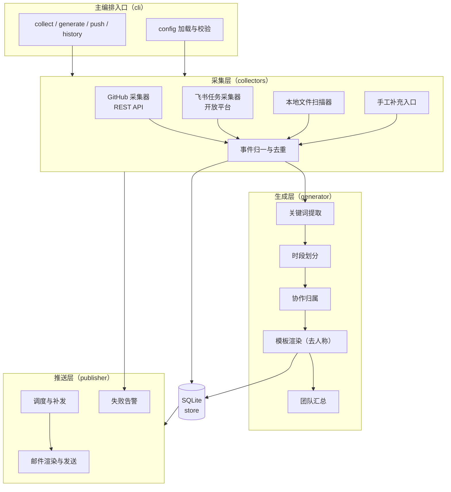
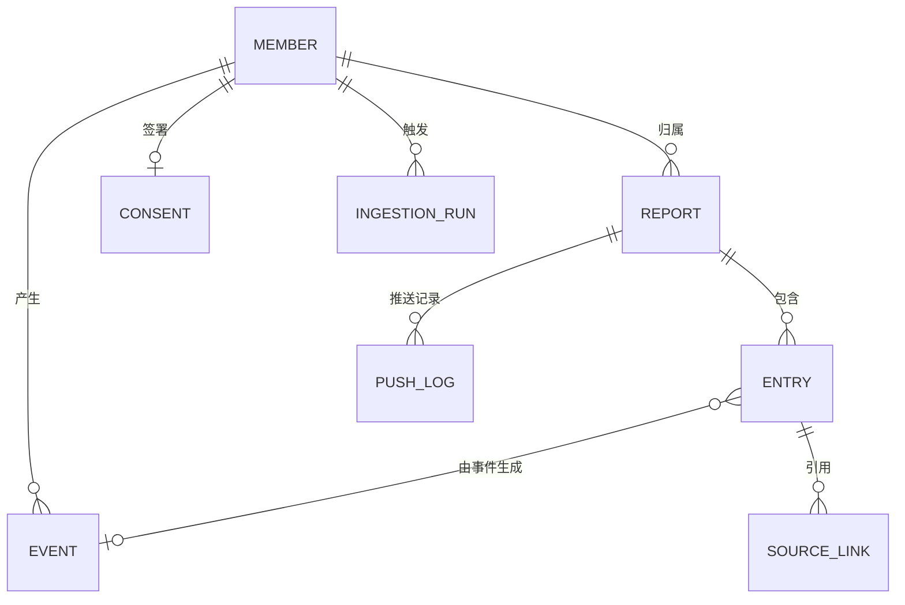

# design.md — 智能日报生成器

> 元信息
>
> | 项 | 内容 |
> |---|---|
> | 文档版本 | v0.2（已与 proposal v0.2 对齐，待第 2 周阶段评审） |
> | 上游规范 | `specs/proposal.md` v0.2（含 §3.2 访谈结论、§8 风险 R1～R6） |
> | 下游规范 | `specs/tasks.md` |
> | 编写角色 | 架构师（〔待填〕） |
> | 评审状态 | 未评审 |
> | 更新日期 | 〔待填〕 |

---

## 1. 系统架构

### 1.1 分层结构

系统按 **采集层 → 生成层 → 推送层** 三层构建，外层由 **主编排入口（CLI）** 串联。层间只通过数据模型与函数契约通信，不允许跨层直接调用。

### 1.2 分层职责与依赖方向

| 层 | 职责 | 允许依赖 | 明确禁止 |
|---|---|---|---|
| 主编排入口 `cli` | 解析命令与参数、加载配置、按序调用各层、聚合退出码 | 全部层 | 不含业务规则 |
| 采集层 `collectors` | 从外部源拉取原始数据并归一为 `Event`，负责去重与失败分类 | 外部 API、`store`（写入） | 不生成日报文本、不做归属判断 |
| 生成层 `generator` | 从 `Event` 生成 `Entry` 与 `Report`，负责时段、状态、语体、归属、汇总 | `store`、`config` | 不发起外部网络请求（纯计算，便于测试） |
| 推送层 `publisher` | 渲染邮件正文、发送、调度与补发、失败告警 | `store`、SMTP | 不修改日报内容 |
| 存储 `store` | 全部持久化读写，屏蔽 SQL 细节 | SQLite | 不含业务判断（如"哪些条目算同一条"） |

> 依赖方向的硬约束：生成层必须可在无网络环境下以固定输入完成测试（对应指导书 TDD 要求），因此外部请求一律收敛在采集层。

### 1.3 关键数据流（一次完整生成）

1. `cli collect` 触发三个采集器并行拉取 → 各自写入 `event` 表（含 `dedupe_key`）
2. `cli generate` 读当日 `event` → 关键词提取 → 时段归位 → 归属判定 → 模板渲染 → 写 `report` + `entry` + `source_link`
3. `cli push` 读当日 `report` → 渲染邮件 → SMTP 发送 → 写 `push_log`
4. 调度器在配置时点执行上述三步；错过时点由补发任务在下次启动时检测并执行

---

## 2. 模块职责（一句话边界）

| 模块 | 路径 | 一句话职责 |
|---|---|---|
| `collectors.github` | `src/sdr/collectors/github.py` | 拉取指定仓库在统计窗口内的提交并归一为 `Event` |
| `collectors.feishu` | `src/sdr/collectors/feishu.py` | 拉取任务流转记录并归一为 `Event` |
| `collectors.local` | `src/sdr/collectors/local.py` | 按修改时间扫描配置目录，识别当日产出文件 |
| `collectors.manual` | `src/sdr/collectors/manual.py` | 接收命令行录入的条目并转为 `Event`（`source=manual`） |
| `collectors.normalize` | `src/sdr/collectors/normalize.py` | 生成 `dedupe_key`、合并多源同一事件、确定主源标记 |
| `generator.extract` | `src/sdr/generator/extract.py` | 按关键词库识别进展阶段，输出 `phase` 与命中置信度 |
| `generator.timeline` | `src/sdr/generator/timeline.py` | 按休息时段将事件归入时间块 |
| `generator.attribution` | `src/sdr/generator/attribution.py` | 依据 `Co-authored-by` 与兜底规则确定协作归属 |
| `generator.render` | `src/sdr/generator/render.py` | 以去人称模板渲染条目与日报正文 |
| `generator.summary` | `src/sdr/generator/summary.py` | 将多人日报聚合为团队日报（仅聚合，不展开他人明细） |
| `publisher.mail` | `src/sdr/publisher/mail.py` | 渲染 MIME 邮件并发送，返回发送结果 |
| `publisher.scheduler` | `src/sdr/publisher/scheduler.py` | 按配置时点触发推送，检测并执行补发 |
| `publisher.alert` | `src/sdr/publisher/alert.py` | 采集或推送失败时发送告警邮件 |
| `store.repo` | `src/sdr/store/repo.py` | 提供 `Event` / `Report` / `Entry` 的增删查接口，屏蔽 SQL |
| `store.schema` | `src/sdr/store/schema.py` | 建表、迁移与约束校验 |
| `config` | `src/sdr/config.py` | 从环境变量与配置文件加载并校验全部设置项 |
| `errors` | `src/sdr/errors.py` | 定义错误码与异常层级，统一错误分类 |

---

## 3. 数据模型

### 3.1 ER 图

### 3.2 表结构

**member**

| 字段 | 类型 | 约束 | 说明 |
|---|---|---|---|
| `id` | INTEGER | PK AUTOINCREMENT | 主键 |
| `github_login` | TEXT | UNIQUE, NOT NULL | GitHub 用户名，采集匹配键 |
| `feishu_open_id` | TEXT | UNIQUE, NULL 允许 | 飞书用户 ID，未接入时为空 |
| `display_name` | TEXT | NOT NULL | 日报中的姓名 |
| `manager_id` | INTEGER | FK → member.id, NULL 允许 | 直属上级，决定可见性 |
| `active` | INTEGER | NOT NULL DEFAULT 1 | 是否在职（0/1） |
| `created_at` | TEXT | NOT NULL | ISO 8601 |

**event**

| 字段 | 类型 | 约束 | 说明 |
|---|---|---|---|
| `id` | INTEGER | PK | 主键 |
| `member_id` | INTEGER | FK → member.id, NOT NULL | 事件归属人 |
| `source` | TEXT | NOT NULL, CHECK IN ('github','feishu','local','manual') | 来源 |
| `source_id` | TEXT | NOT NULL | 源侧唯一标识（commit sha / task id / 文件路径+hash） |
| `kind` | TEXT | NOT NULL | 事件类型（commit / task_done / file_change / note） |
| `occurred_at` | TEXT | NOT NULL | 发生时间，用于时段归位 |
| `title` | TEXT | NOT NULL | 短标题，进正文字段 |
| `detail` | TEXT | NULL | 补充说明（提交信息正文等） |
| `dedupe_key` | TEXT | UNIQUE, NOT NULL | 去重键：`sha1(source_id + occurred_at 日期 + member_id)` 或归一后的业务键 |
| `is_primary` | INTEGER | NOT NULL DEFAULT 0 | 是否主源事件（1=主源，0=辅助） |
| `payload` | TEXT | NULL | 原始 JSON，便于追溯 |
| `created_at` | TEXT | NOT NULL | 入库时间 |

**report**

| 字段 | 类型 | 约束 | 说明 |
|---|---|---|---|
| `id` | INTEGER | PK | 主键 |
| `member_id` | INTEGER | FK → member.id, NOT NULL | 归属人 |
| `report_date` | TEXT | NOT NULL | 日期（YYYY-MM-DD） |
| `status` | TEXT | NOT NULL, CHECK IN ('draft','confirmed','leave','blank') | 状态，`leave` 与 `blank` 语义不同 |
| `body` | TEXT | NULL | 渲染后的邮件正文 |
| `generated_at` | TEXT | NOT NULL | 生成时间 |
| `pushed_at` | TEXT | NULL | 推送时间 |
| — | — | UNIQUE(member_id, report_date) | 一人一日一份 |

**entry**

| 字段 | 类型 | 约束 | 说明 |
|---|---|---|---|
| `id` | INTEGER | PK | 主键 |
| `report_id` | INTEGER | FK → report.id, NOT NULL | 所属日报 |
| `time_block` | TEXT | NOT NULL | 时段标识（morning / afternoon / evening / custom） |
| `state` | TEXT | NOT NULL, CHECK IN ('done','doing','plan','blocked') | 状态分类 |
| `content` | TEXT | NOT NULL | 去人称陈述 |
| `order_index` | INTEGER | NOT NULL | 同时段内排序 |
| `source_event_id` | INTEGER | FK → event.id, NULL | 由哪条事件生成；手工条目为空 |
| `is_manual` | INTEGER | NOT NULL DEFAULT 0 | 是否手工补充 |

**source_link**

| 字段 | 类型 | 约束 | 说明 |
|---|---|---|---|
| `id` | INTEGER | PK | 主键 |
| `entry_id` | INTEGER | FK → entry.id, NOT NULL | 所属条目 |
| `link_type` | TEXT | NOT NULL, CHECK IN ('url','path') | 链接形态 |
| `target` | TEXT | NOT NULL | 提交地址或文件路径 |

**ingestion_run / push_log / consent**（审计与合规）

| 表 | 关键字段 | 用途 |
|---|---|---|
| `ingestion_run` | `source`, `started_at`, `finished_at`, `result`(ok/partial/failed), `error_code`, `error_msg` | 每次采集留痕，支撑"失败标注原因"（CS-07） |
| `push_log` | `report_date`, `channel`, `sent_at`, `result`, `retry_count` | 推送与补发留痕（CS-08） |
| `consent` | `member_id`, `agreed_at`, `scope` | 成员知情同意记录，合规证据（proposal 技术约束） |

### 3.3 关键约束说明

1. `dedupe_key` 唯一约束是去重准确率 100%（CS-01）的实现基础，重复采集由数据库层面拒绝。
2. `report.status` 的四个取值互斥，`leave`（未出勤）与 `blank`（出勤无进展）不可混用（对应 IR-01）。
3. 归属关系不落独立表，而由 `entry.source_event_id → event.member_id` 与 `source_link` 组合表达：一条条目只能指向一个事件，但一个事件可被多条条目引用（`event` 与 `entry` 为 1:N 的可选关系）。
4. 日报正文同时存于 `report.body`（快照）与 `entry` 行（结构化）；编辑以 `entry` 为准，推送前重新渲染 `body`，避免两处不一致。

---

## 4. 接口契约

### 4.1 CLI 命令

| 命令 | 入参 | 出参 / 退出码 | 行为约束 |
|---|---|---|---|
| `sdr collect` | `--date`（默认今日）、`--source`（可重复，缺省全部） | 退出码 0=全部成功、3=部分失败、4=全部失败 | 单源失败不影响其他源；每次执行写一条 `ingestion_run` |
| `sdr generate` | `--date`、`--member`（缺省全部在册成员） | 退出码 0=成功、5=无可生成数据（输出空白模板，仍返回 0，见 CS-14） | 已存在 `confirmed` 日报时不覆盖，除非 `--force` |
| `sdr edit` | `--date`、`--member`、`--add-text`、`--remove-entry` | 0=成功、6=条目不存在 | 编辑后 `status` 置回 `draft` |
| `sdr push` | `--date`、`--dry-run` | 0=成功、7=发送失败（已告警） | `--dry-run` 只渲染不发送，输出正文供核对 |
| `sdr history` | `--member`、`--from`、`--to` | 0=成功、8=无权访问 | 校验调用者身份（本人或直属上级），否则拒绝（CS-09） |
| `sdr serve` | 无 | 常驻进程 | 启动调度器，按配置时点推送并处理补发 |

统一退出码约定：`0` 成功、`2` 参数错误、`3` 部分失败、`4` 采集全失败、`5` 无数据、`6` 条目不存在、`7` 推送失败、`8` 权限拒绝、`9` 配置非法。

### 4.2 模块函数契约（节选核心）

| 函数 | 签名 | 入参约束 | 出参 | 错误码 | 行为约束 |
|---|---|---|---|---|---|
| `github.collect` | `(repo: str, since: datetime, until: datetime, token: str) -> list[Event]` | `repo` 形如 `owner/name`；时间区间左闭右开 | 已归一的 `Event` 列表（可为空） | `SDR-E101` 令牌失效、`SDR-E102` 速率限制、`SDR-E103` 网络超时 | 超时重试 ≤ 3 次，退避 1/2/4 秒；仍失败抛错，不返回部分结果 |
| `feishu.collect` | `(tasklist_id: str, since: datetime, app_token: str) -> list[Event]` | — | 同上 | `SDR-E201` 授权失败、`SDR-E202` 字段缺失 | 任务状态映射固定（完成→done），未知状态归 `doing` |
| `normalize.dedupe` | `(events: list[Event]) -> list[Event]` | 输入可含重复 | 去重后列表，主源优先保留 | — | 同一 `dedupe_key` 仅保留 `is_primary=1` 或最早入库者 |
| `extract.phase` | `(text: str, rules: list[KeywordRule]) -> tuple[Phase, float]` | `text` 非空 | 阶段 + 置信度 0~1 | — | 无命中返回 `(DOING, 0.0)`，不猜测 |
| `timeline.assign` | `(events: list[Event], work_hours: WorkHours) -> dict[str, list[Event]]` | 时段定义非空且互不重叠 | 时段 → 事件列表 | `SDR-E301` 配置时段重叠 | 落在休息区间的事件归入前一工作时段（IR-05） |
| `attribution.resolve` | `(event: Event, repo_index: RepoIndex) -> list[Member]` | — | 归属成员列表（至少 1 个） | — | 有 `Co-authored-by` 时 100% 采纳；无标记时按 ADR-004 兜底，兜底失败归提交作者 |
| `render.entry` | `(event: Event, phase: Phase) -> str` | — | 去人称单句 | — | 输出不得含第一人称代词（CS-05）；句长 ≤ 60 字 |
| `summary.build` | `(reports: list[Report]) -> TeamSummary` | 全部属同一日期 | 聚合结果（计数 + 时段分布） | — | 不得包含他人条目正文（CS-09） |
| `mail.send` | `(to: list[str], subject: str, body: str) -> PushResult` | 收件人非空 | 结果对象 | `SDR-E401` 认证失败、`SDR-E402` 连接超时 | 失败抛出，由 `alert` 记录并告警，不重试超过 2 次 |

### 4.3 错误码表

| 码段 | 类别 | 处理策略 |
|---|---|---|
| `SDR-E1xx` | GitHub 采集 | 记录 `ingestion_run`，标注原因并告警，其余源继续 |
| `SDR-E2xx` | 飞书采集 | 同上 |
| `SDR-E3xx` | 配置错误 | 启动即失败，退出码 9，不产生半成品 |
| `SDR-E4xx` | 推送 | 记录 `push_log`，告警，进入补发队列 |
| `SDR-E5xx` | 存储 | 事务回滚后抛出，不落不完整数据 |

---

## 5. 技术选型 ADR

### 5.0 ADR 索引与追溯

六份 ADR 与上游提案的对应关系如下。评审时按"提案条目 → ADR → 实现模块"三层追溯。

| ADR | 主题 | 状态 | 解决的上游项 | 落地模块 |
|---|---|---|---|---|
| ADR-001 | 外部 HTTP 客户端 | 已接受 | 提案 §5 技术约束（外部依赖） | `src/sdr/http.py` |
| ADR-002 | 存储方案 | 已接受 | R2（多源取舍需存储层保证唯一性） | `store/schema.py`、`store/repo.py` |
| ADR-003 | 生成策略 | 已接受 | EX-04（排除生成式）、CS-04 | `generator/render.py` |
| ADR-004 | 归属规则与兜底 | 已接受 | **R3**（高）、G-03、CS-03 | `generator/attribution.py` |
| ADR-005 | 时段划分与配置 | 已接受 | 提案 §5.1 待决策 3、IR-05 | `generator/timeline.py` |
| ADR-006 | 汇总可见性与粒度 | 已接受 | **R6**（高）、IR-07、CS-09 | `generator/summary.py` |

> 未被 ADR 覆盖的上游项：R1（群聊采集）已由提案 EX-01、EX-02 排除，无需设计决策；R4（可解释性）由 CS-04 的来源链接要求承接，不构成选型问题；R5（状态语义）落在 §3.2 的 `report.status` 约束中。

### ADR-001 外部 HTTP 客户端选型

| 项 | 内容 |
|---|---|
| 状态 | 已接受 |
| 背景 | 需调用 GitHub REST API 与飞书开放平台，要求可测试、可设超时与重试，且不引入异步复杂度 |

| 备选项 | 评估 | 结论 |
|---|---|---|
| `requests` | 生态成熟、文档丰富；无内置重试，需自写适配器 | 否决：重试逻辑重复实现，测试打桩样式不统一 |
| `httpx`（同步模式） | 内置超时与重定向控制，接口与 `requests` 近似，支持 `MockTransport` 直接注入假响应 | **采纳** |
| `aiohttp` | 并发能力强，但引入 `asyncio` 会扩散到全部层，与"生成层无网络"的边界原则冲突 | 否决：复杂度与收益不匹配（单团队 ≤ 10 人，请求量小） |

**决策**：采用 `httpx` 同步客户端，封装于 `src/sdr/http.py`，统一超时（连接 5s / 读取 15s）与重试（≤ 3 次，指数退避）。

**理由**：`MockTransport` 使采集层可在无网络条件下完成 TDD 红绿循环，这是本周最关键的工程约束；同步模型避免异步传染。

**后果**：多源采集为串行执行，单次生成时延约为各源之和；在 ≤ 10 人规模下实测应满足 CS-11（30 秒），若超限则由 ADR-001-S 记录改进方案（并发接缝保留在 `cli` 层）。

---

### ADR-002 存储方案选型

| 项 | 内容 |
|---|---|
| 状态 | 已接受 |
| 背景 | 需持久化日报历史（永久保留）、支撑按人按日查询（CS-10），且为单机命令行工具 |

| 备选项 | 评估 | 结论 |
|---|---|---|
| 纯文件（JSON / Markdown 目录） | 零依赖、易人工查看；但去重需全量加载、并发写有风险、查询需自行索引 | 否决：`dedupe_key` 唯一性无法由存储层保证 |
| SQLite | 单文件、零运维、唯一约束与事务原生支持，Python 标准库可用 | **采纳** |
| PostgreSQL | 能力强；需独立服务与连接管理，课程环境增加部署成本 | 否决：为单机单团队工具引入服务端依赖属过度设计 |

**决策**：SQLite，数据库文件位于 `data/sdr.db`（不入仓，见 `.gitignore`），通过 `store/repo.py` 单点访问，禁止其他模块直接执行 SQL。

**理由**：CS-01 的去重准确率 100% 与 CS-10 的检索 2 秒要求，均可由唯一约束与索引直接满足；事务保证"日报 + 条目 + 来源链接"原子写入。

**后果**：多进程并发写需开启 WAL 模式；`store` 层承担全部 SQL，未来换库只需替换该层实现。

---

### ADR-003 日报生成策略：规则模板 vs 生成式

| 项 | 内容 |
|---|---|
| 状态 | 已接受（与 proposal EX-04 一致） |
| 背景 | 需从事件生成去人称、分时段的条目，且每条须可追溯到来源（IR-06） |

| 备选项 | 评估 | 结论 |
|---|---|---|
| 规则模板拼接 | 输出完全可复现、可断言测试、来源一一对应；表达略显机械 | **采纳** |
| LLM 生成措辞 | 表达自然；但同一输入多次输出不同、单测无法断言、来源追溯断裂 | 否决：与 CS-04（来源缺失率 0）和可测试性直接冲突，且属 proposal EX-04 排除项 |
| 混合（模板 + LLM 润色，可开关） | 兼顾两者；但开关组合使测试矩阵翻倍，4 周工期内不可控 | 否决：v1.1 再议 |

**决策**：v1 全部由规则模板生成，模板以字符串模板文件存放于 `src/sdr/templates/`，去人称通过固定句式与代词过滤双重保证。

**理由**：可测试性优先。生成的每条条目必须能回答"它来自哪条事件"，生成式改写会切断该链路。

**后果**：条目语言较机械，接受这一代价；若后续引入生成式，须保留原文并标注来源，且作为独立 ADR 重新评估。

---

### ADR-004 协作归属规则与兜底策略

| 项 | 内容 |
|---|---|
| 状态 | 已接受（对应提案 §8 R3，高等级风险） |
| 背景 | 仅依赖 `Co-authored-by` 标记时，实际团队中该标记出现率偏低，大量协作成果将无归属 |

| 备选项 | 评估 | 结论 |
|---|---|---|
| 仅 `Co-authored-by` | 规则最简、100% 准确（有标记时） | 否决：覆盖率不足，G-03 目标无法达成 |
| 同一文件路径历史作者（近 30 天） | 覆盖广；但会把"长期共同维护同一文件"的无关人员牵连进来 | 否决：误归率高，损害信任 |
| 时间窗重叠（同一任务 24 小时内均有人操作） | 与飞书任务联动，语义较准；依赖任务关联质量 | **采纳为一级兜底** |
| 人工认领 | 最准确；纯人工等于回到手工填日报 | 采纳为**二级兜底**：生成后在 `sdr edit` 中可增删归属人 |

**决策**：三级策略——① 有 `Co-authored-by` 标记则严格按标记归属（命中率 100%）；② 无标记但存在同一任务的多人流转记录，则归属到该任务的全部操作者，并在条目末尾标注"（协作）"；③ 仍无法判定时归提交作者，同时将该条目标记为"待确认"，在 `sdr generate` 输出中以 `[待确认]` 前缀提示，成员可在 `sdr edit` 中认领。

**理由**：把不确定性显式化，而不是用概率算法掩盖。宁可标"待确认"，也不做可能错误的自动分配（IR-06 信任要求）。

**后果**：日报中可能出现少量 `[待确认]` 条目，需成员一次确认；该指标须纳入第 4 周质量数据（待确认条目占比）。

---

### ADR-005 时段划分与休息时间配置

| 项 | 内容 |
|---|---|
| 状态 | 已接受（对应提案 §5.1 待决策 3、IR-05） |
| 背景 | 条目需按工作时段归位；午休跨越会导致"上午/下午"叙事错位，且不同团队作息不同 |

| 备选项 | 评估 | 结论 |
|---|---|---|
| 固定自然小时（09-12、13-18） | 实现最简；但作息不同的团队全错位 | 否决：与"可配置"要求冲突 |
| 按自然日顺序编号（时段 1/2/3） | 无需配置；但对读者无语义 | 否决：邮件正文可读性差 |
| 可配置时段表（名称 + 起止 + 工作日） | 表达清晰、适配不同作息；增加一个配置项与校验 | **采纳** |
| 接入考勤系统自动获取 | 最准确；需外部授权，属 proposal EX-05 排除项 | 否决：范围外 |

**决策**：配置文件 `config/work_hours.toml` 定义时段表（默认：上午 09:00–12:00、下午 13:30–18:00、晚间 19:00–22:00），支持自定义名称与任意段数；校验规则为"时段不重叠、按起点递增、每个工作日至少一段"（违反抛 `SDR-E301`）。

**理由**：时段是叙事结构而非统计维度，命名权应交由团队；配置化成本仅一个 TOML 文件与一次校验。

**后果**：落在休息区间的事件（如 12:30 的提交）归入前一工作时段，并在渲染时按发生时间排序；跨时段事件（如持续 3 小时的任务）只取开始时间归位，避免重复出现。

---

### ADR-006 团队汇总的可见性与聚合粒度

| 项 | 内容 |
|---|---|
| 状态 | 已接受（对应提案 §8 R6、IR-07，高等级风险） |
| 背景 | 日报"仅本人与直属上级可见"，但团队汇总需要覆盖全组；若汇总展开明细则突破可见边界，且涉及隐私红线 |

| 备选项 | 评估 | 结论 |
|---|---|---|
| 汇总展开各成员条目正文 | 信息最全；直接违反可见性约束（CS-09），且与指导书隐私红线冲突 | 否决 |
| 汇总仅含条目计数与状态分布 | 合规；但组长难以发现阻塞 | 采纳**基础形态** |
| 汇总含条目计数 + 阻塞项摘要（不含其他明细） | 合规与可用的折中：阻塞项本就是"需要支持"的信号，属组内共知信息 | **采纳** |
| 汇总不做，仅逐人邮件 | 最简单；但失去"免除组长手工汇总"目标（G-04） | 否决 |

**决策**：团队日报包含三段——① 成员出勤与状态矩阵（正常/请假/空白）；② 每人条目数与完成/进行中/阻塞分布；③ 阻塞项汇总（仅阻塞条目正文，其余条目不展开）。

**理由**：阻塞项的信息价值在于"被看见并解决"，其可见范围与"向团队求助"的业务语义一致；其余明细保持私密。

**后果**：汇总邮件的收件人为组长；成员可申请查看汇总（只读）；该规则须在系统说明中明示，避免成员误解为"日报被公开"。

---

## 6. 非功能性约束

| 类别 | 约束 | 验证方式 |
|---|---|---|
| 性能 | 单成员单日生成 ≤ 30 秒（P95）；团队汇总 ≤ 60 秒；历史查询 ≤ 2 秒（≤ 1000 条） | 第 2 周实测记录，写入测试报告 |
| 性能 | 外部 API 调用 ≤ 速率限制的 50% | 代码审查 + 请求计数日志 |
| 安全 | 凭证仅经环境变量注入，代码与仓库不含任何密钥；启动时校验必需变量缺失则退出码 9 | CI 静态扫描 + 人工审查 |
| 安全 | 数据访问按 `member_id` 过滤，非本人且非直属上级的查询返回退出码 8 | 单元测试覆盖（CS-09） |
| 安全 | 日志不得输出完整令牌（超过 8 位一律掩码） | 审查日志样例 |
| 合规 | 采集前须存在 `consent` 记录，缺失时 `collect` 拒绝执行并提示 | 集成测试 |
| 兼容 | Python 3.12+；macOS 与 Linux 命令行均可运行 | CI 双平台或本地双环境验证 |
| 可维护性 | 类型注解完整，`mypy --strict` 通过；关键路径函数覆盖率 ≥ 80% | CI 门禁 |
| 可维护性 | 单文件 ≤ 300 行；生成层不得 import 采集层 | 静态规则检查 |
| 可观测性 | 每次采集/推送写一条审计记录；错误日志含错误码与源标识 | 日志样例审查 |
| 可观测性 | `[待确认]` 归属条目占比须可统计（ADR-004 的后果指标） | 生成报告的统计行 |

---

## 7. 待补充（第 2 周完成）

- UML 图正式版：用例图、类图、ER 图、泳道图（用绘图工具绘制，作为本文件附件，Markdown 内 mermaid 仅作草稿）
- 性能实测数据：ADR-001 中"并发改进方案"的触发判定依据
- `config/work_hours.toml` 与 `.env.example` 的字段清单定稿
- ADR-004 的实测校准：`Co-authored-by` 覆盖率与 `[待确认]` 条目占比的基线数据，决定是否需要调整提案 G-03 的 80% 目标
- 工时校准：tasks.md 预估 112 人时，较 3 人组第 2 周可用工时（约 90 人时）超出 24%，须在第 2 周首日按削减策略裁剪并回写 tasks.md

