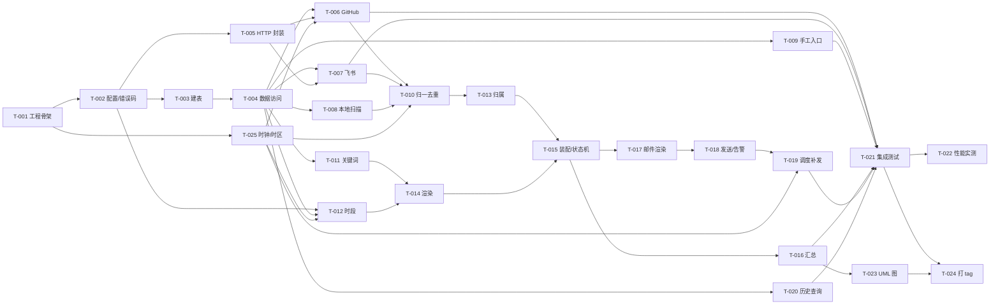

# tasks.md — 智能日报生成器（阶段一 v1 / SDD）

> 元信息
>
> | 项 | 内容 |
> |---|---|
> | 文档版本 | v0.3（按 `design.md` v0.4 与评审单同步任务验收标准） |
> | 上游规范 | `specs/proposal.md` v0.4、`specs/design.md` v0.4 |
> | 覆盖范围 | 阶段一 v1（FR-01～FR-12） |
> | 编写角色 | 架构师（〔待填〕）、开发工程师（〔待填〕） |
> | 更新日期 | 2026-11-25 |

**拆分原则**：一个任务 = 一个可验证的交付物；单任务预估 ≤ 8 人时；每个任务至少对应一条验收标准（CS 编号）。任务描述中不得出现"实现后台""完成采集模块"这类不可验证的表述。

**v0.3 变更**：与 design.md v0.4 对齐——新增 T-025（时钟与时区日界）；T-006 补分页超限行为、T-009 补来源说明、T-013 改为多作者归属、T-016 改为投影白名单、T-017 收敛为纯文本。**删除 v0.2 削减策略中"T-016 降级为仅出勤矩阵"一项**：T-016 是 CS-09 与 ADR-006 的唯一实现载体，降级等于撤销隐私边界，属规范冲突而非工期调整（评审 R-14）。工时 116 → 123 人时。

---

## 1. 里程碑与门禁

| 里程碑 | 包含任务 | 门禁条件（全部满足才可进入下一里程碑） |
|---|---|---|
| M0 工程基线 | T-001～T-002、T-025 | `pnpm typecheck`、`pnpm lint`、`pnpm test` 三条命令均可执行且零错误 |
| M1 存储 | T-003～T-004 | 建表幂等、唯一约束生效、数据访问层无裸 SQL 外泄 |
| M2 采集 | T-005～T-010 | 三源采集可独立运行，去重在数据库层生效 |
| M3 生成 | T-011～T-016 | 固定输入可产出符合 CS-01～CS-06、CS-16、CS-19 的日报 |
| M4 推送 | T-017～T-020 | `--dry-run` 正文可核对，推送与补发留痕完整 |
| M5 验收 | T-021～T-024 | CS-01～CS-19 全覆盖，集成测试记录归档，可打 tag |

---

## 2. 任务清单

### M0 工程基线

| 编号 | 标题 | 交付物 | 验收标准 | 依赖 | 预估 |
|---|---|---|---|---|---|
| T-001 | 建立工程骨架与工具链 | `package.json`（pnpm）、`tsconfig.json`（`strict`）、`eslint.config.js`、`.prettierrc`、`vitest.config.ts`、`src/`、`tests/` | `pnpm typecheck` / `pnpm lint` / `pnpm test` 三条命令均可执行且零错误（0 用例视为通过）；`tsconfig` 开启 `strict`、`noUncheckedIndexedAccess`、`exactOptionalPropertyTypes`；三人机器各执行一次 `pnpm install` 通过（`better-sqlite3` 预编译可用性验证，ADR-002） | — | 5h |
| T-002 | 配置加载与错误码体系 | `src/config.ts`（zod schema）、`src/errors.ts`（`SdrError`）、`.env.example` | 缺少必需环境变量时退出码 9 并给出变量名；`SDR-E1xx～E6xx` 六段码均有单元测试（含 E104、E601）；`SdrError` 含 `code`/`source`/`cause` 三者；`exitCode()` 对 E3xx→9、E4xx→7、E6xx→10、其余→1 逐一断言；`.env.example` 不含任何真实值 | T-001 | 5h |
| T-025 | 时钟与时区日界 | `src/clock.ts`（`Clock` 端口、`systemClock`、`dayKey`、`dayWindow`）、`tests/clock.test.ts` | `FixedClock` 下 `dayKey('2026-11-25T16:30:00Z')` 返回 `2026-11-26`、`dayKey('2026-11-25T15:59:59Z')` 返回 `2026-11-25`；`dayWindow` 返回左闭右开边界；结果与进程 `TZ` 无关（`TZ=UTC` 与 `TZ=Asia/Shanghai` 结果一致）；ESLint 规则禁止业务模块直接使用 `new Date()`（`clock.ts` 与测试除外） | T-001 | 3h |

> T-025 为追加编号：既有 T-001～T-024 已被代码注释与提交信息引用，重排会破坏可追溯性，故追加而不插入。

### M1 存储

| 编号 | 标题 | 交付物 | 验收标准 | 依赖 | 预估 |
|---|---|---|---|---|---|
| T-003 | 建表脚本与约束校验 | `store/schema.ts`、`tests/store/schema.test.ts` | 对空库重复执行初始化幂等；插入重复 `dedupe_key` 抛 `SQLITE_CONSTRAINT_UNIQUE`；`report.status` / `entry.state` / `link_type` 非法值被 CHECK 拒绝；`entry_member` 主键去重生效（同一 `entry_id` + `member_id` 重复插入失败）；`PRAGMA foreign_keys` 生效（插入无效外键失败） | T-002 | 5h |
| T-004 | 数据访问层与行映射 | `store/repo.ts`（`Event`/`Report`/`Entry`/`EntryMember`/`SourceLink` 读写 + `snake_case`→`camelCase` 映射 + `acceptAttribution`） | 各实体 CRUD 单测覆盖 ≥ 80%；`src/` 内除 `store/` 外无 `better-sqlite3` 的 import（ESLint 规则验证）；事务回滚测试通过（`report` + `entry` + `entry_member` + `source_link` 四表原子写入）；重复 `dedupeKey` 被转换为幂等返回而非抛错；`acceptAttribution(reportId, true)` 一次调用确认该日报全部 `[待确认]` 条目并返回条数 | T-003 | 8h |

### M2 采集

| 编号 | 标题 | 交付物 | 验收标准 | 依赖 | 预估 |
|---|---|---|---|---|---|
| T-005 | HTTP 客户端封装 | `src/http.ts`（`fetch` + `AbortSignal.timeout` + 手写指数退避 + 日志掩码） | 用 `undici` `MockAgent` 模拟超时，重试恰好 3 次且退避为 1/2/4 秒；仅 `408/429/5xx` 与网络错误触发重试，`400/401/403/404` 不重试（唯一重试方案见 ADR-001，不得引入 `p-retry`）；日志中令牌为掩码（>8 位全部替换）；`http.ts` 不 import 任何业务模块（ESLint 验证）；运行时依赖仅 `zod`/`better-sqlite3`/`nodemailer`，`undici` 为 devDependency（与 `package.json` 一致） | T-002 | 4h |
| T-006 | GitHub 提交采集器 | `collectors/github.ts`、`tests/fixtures/github_commits.json`、`github_commits_overflow.json` | 固定 fixture 输入产出预期条数 `Event`；401→`SDR-E101`、403+限流头→`SDR-E102`、超时→`SDR-E103`；250 条 fixture 跨 3 页返回全部；**2001 条 fixture 达 20 页上限时抛 `SDR-E104`，不返回部分结果**；`occurredAt` 保留 `+08:00` 偏移；时间参数由 `dayWindow` 生成 | T-004、T-005、T-025 | 7h |
| T-007 | 飞书任务采集器 | `collectors/feishu.ts`、状态映射表 | 任务状态映射逐条断言（完成→done，未知→doing）；授权失败映射 `SDR-E201`；字段缺失映射 `SDR-E202` | T-004、T-005 | 6h |
| T-008 | 本地文件扫描器 | `collectors/local.ts` | 仅返回统计窗口内 `mtime` 变更的文件；跳过固定忽略名单（`.git`、`node_modules`、`dist`、`data`）；路径为绝对路径；不追踪符号链接 | T-004 | 3h |
| T-009 | 手工补充入口 | `collectors/manual.ts` + `sdr collect --manual --ref` | `--manual` 与 `--ref` 必须成对出现，缺一即参数错误（退出码 2）；录入生成 `source='manual'` 的 `Event` 及 `link_type='note'` 的 `SourceLink`；空字符串与纯空白被拒绝并提示；单次可录入多条 | T-004 | 4h |
| T-010 | 事件归一与去重 | `collectors/normalize.ts` | 同一 commit 采集两次入库仅 1 条（CS-01）；跨 UTC 日界的同一提交去重键一致（CS-19，`FixedClock` 断言）；多源同一事件保留主源 `isPrimary=true`；结果按 `occurredAt` 升序；`dedupeKey` 生成函数有独立单测（同输入同输出，日期部分取自 `dayKey`） | T-006、T-007、T-008、T-025 | 5h |

### M3 生成

| 编号 | 标题 | 交付物 | 验收标准 | 依赖 | 预估 |
|---|---|---|---|---|---|
| T-011 | 关键词规则库与状态判定 | `generator/extract.ts`、`config/keywords.yaml` | 人工标注 ≥ 20 条样本，`EntryState` 判定准确率 ≥ 90%；无命中返回 `{ state: 'doing', confidence: 0 }`；规则非法正则在校验阶段被拒 | T-004 | 5h |
| T-012 | 时段划分 | `generator/timeline.ts`、`config/work-hours.yaml` | 落在休息区间的事件归入前一工作时段（IR-05）；时段重叠或乱序抛 `SDR-E301`；跨时段事件只按开始时间归位一次；时刻解释使用 `clock.timeZone` 而非进程 TZ；zod 校验失败信息含具体字段名 | T-002、T-004、T-025 | 4h |
| T-013 | 协作归属三级策略 | `generator/attribution.ts` | 含 `Co-authored-by` 的多作者提交返回全部作者（提交作者 `role='primary'`，其余 `'co'`）、`kind='coauthor'`、`confirmed=true`，`entry_member` 写入 N 行（CS-03）；无标记但命中任务时间窗 → `kind='task_window'`、`confirmed=true`，条目末尾标注"（协作）"；仍无法判定 → `kind='fallback'`、`confirmed=false`，渲染 `[待确认]`；三条路径各有用例；禁止以 `event.member_id` 单值冒充归属 | T-010 | 8h |
| T-014 | 去人称渲染 | `generator/render.ts`、`generator/phrases.ts` | 输出不含"我/我们/咱"等第一人称，命中数 0（CS-05）；单句 ≤ 60 字；`links` 为空抛 `SDR-E601`（CS-04 缺失率 0）；`link_type='note'` 渲染为"来源：<说明>"而非 URL；`confirmed=false` 加 `[待确认]` 前缀、`members.length > 1` 加"（协作）"后缀、`originalDate` 非空加"（自 MM-DD 起）"前缀；快照测试覆盖 5 类事件 × 4 种状态 × 3 种链接形态 | T-011、T-012 | 5h |
| T-015 | 日报装配与状态机 | `generator/report.ts` | 请假生成占位条目而非空文件；无事件生成可编辑空白模板（CS-06、CS-14）；跨天任务写入 `original_date`（CS-16）；`confirmed` 日报不被覆盖，除非 `--force`；一人一日仅一份（唯一约束验证）；`report.body` 与 `entry` 渲染结果一致（推送前重渲染） | T-013、T-014 | 5h |
| T-016 | 团队汇总 | `generator/summary.ts`、`store/repo.ts` 中的 `findSummaryRows` | 汇总含出勤矩阵、条目计数与状态分布、阻塞定位（成员 + 条数 + 查看命令）；**查询 SQL 只 SELECT `display_name`/`status`/`state`/`COUNT(*)`，白盒断言查询语句不含 `content` 列**（CS-09、ADR-006）；≥ 2 人固定数据快照测试通过；不得以"渲染时过滤"替代查询层投影 | T-015 | 6h |

### M4 推送

| 编号 | 标题 | 交付物 | 验收标准 | 依赖 | 预估 |
|---|---|---|---|---|---|
| T-017 | 邮件渲染（纯文本） | `publisher/mail.ts`（渲染部分） | `sdr push --dry-run` 输出正文与 golden 文件逐字一致；纯文本正文可生成；主题含日期与成员名；**HTML 正文不在本期范围（proposal EX-08），不得顺手实现** | T-015 | 3h |
| T-018 | SMTP 发送与失败告警 | `publisher/mail.ts`（发送部分，`nodemailer`）、`publisher/alert.ts` | 认证失败写 `push_log` 并触发一封告警邮件，标注错误类型（CS-07）；采集失败同样告警且不影响其他源；`SDR-E104` 分页超限同样进入告警（IR-02）；`nodemailer` 以 `streamTransport` 在测试中替代真实 SMTP | T-017 | 4h |
| T-019 | 调度与补发 | `publisher/scheduler.ts` | 修改推送时间后下次推送按新时间执行；模拟错过时点，补发在 5 分钟内完成（CS-08）；补发不产生重复邮件（以 `push_log` 去重）；时间一律取自注入的 `Clock`（`FixedClock` 驱动测试，不依赖真实时间与进程 TZ） | T-018、T-025 | 6h |
| T-020 | 历史查询与权限校验 | `sdr history` 实现 | 越权查询返回退出码 8（CS-09）；1000 条数据下查询 ≤ 2 秒（CS-10）；支持 `--from/--to` 区间 | T-004 | 4h |

### M5 验收

| 编号 | 标题 | 交付物 | 验收标准 | 依赖 | 预估 |
|---|---|---|---|---|---|
| T-021 | 端到端集成测试 | `tests/integration/`（固定数据 → 采集 → 生成 → `--dry-run` 推送） | **CS-01～CS-19** 每条至少一个对应用例，用例与标准编号一一标注；覆盖率 ≥ 70%；全程无真实网络（`MockAgent` 全局拦截，未拦截请求即失败）；含 UTC 16:00 跨界样本（CS-19）与四表原子写入样本 | T-006～T-020 | 8h |
| T-022 | 性能实测与指标回填 | `docs/测试记录.md` 实测章节 | CS-11（≤ 30 秒）、CS-12（≤ 60 秒）有实测数据与运行环境说明；超限时记录原因与改进项（触发 ADR-001 的分页/并发改进） | T-021 | 3h |
| T-023 | UML 正式图与附件 | 用例图、类图、ER 图、泳道图（绘图工具产物）+ `design.md` 附件索引 | 四类图齐全；类图含 `EntryMember` 与 `Clock`，且与 `src/` 实际模块一致；ER 图含 9 张表；泳道图与 ADR-004/005/007 的归属、时段、时钟流程一致 | T-016 | 6h |
| T-024 | v1 交付核对与打 tag | 集成测试记录、规范一致性自查表、tag `v1-sdd` | 全量测试通过；`docs/` 已归档测试记录；`specs/` 与实际实现无偏离（偏离须修订规范而非改实现）；`pnpm build` 产物可执行 | T-021～T-023 | 3h |

**合计预估**：**123 人时**（v0.2 为 116，差额 +7：T-006 +1 分页超限、T-009 +1 来源说明、T-013 +2 多作者归属、T-016 +1 投影白名单、T-017 −1 去 HTML、新增 T-025 +3）。按 3 人组第 2 周可用工时（3 人 × 5 天 × 6 小时 = 90 人时）计算，**超出约 37%**。

**削减策略（按顺序执行，不得跳序；每项削减须回写 proposal 的"不做什么"或"待办交接"）**：

1. T-022 与 T-023 并行压缩（9h → 6h），省 3h
2. T-011 的标注样本由 20 条降至 10 条（准确率门槛保持 ≥ 90%），省 1h
3. T-008 的忽略名单固定为常量白名单，不做可配置，省 1h
4. T-023 用同一绘图工具模板批量产出四图，不做美化，省 2h
5. 仍超限时，`sdr history` 的区间导出改用 `sqlite3` 命令行示例文档替代实现，省 2h —— **此项会使 CS-10 无法验收，执行前必须修订 proposal §6.1 并说明理由**

> **禁止削减项**：T-016（汇总投影）、T-013（多作者归属）、T-025（时钟日界）。三者分别是 CS-09、CS-03、CS-19 的唯一实现载体，削减等于撤销评审已闭合的缺陷（R-01、R-02、R-04），属规范冲突而非工期调整。
>
> 削减 1–4 全部执行后为 116 人时，**仍超可用工时约 29%**。处置建议（须在第 2 周第一日与指导教师确认其一）：(a) 将 T-022/T-023 顺延至第 3 周初（阶段二首周尚有 SDD 收尾窗口）；(b) 组内追加第 2 周工时；(c) 正式缩减范围并回写 proposal 的"不做什么"。

---

## 3. 依赖图

**关键路径**：T-001 → T-002 → T-003 → T-004 → T-006 → T-010 → T-013 → T-015 → T-017 → T-018 → T-019 → T-021 → T-024（**70 人时**，为第 2 周排期主线）。T-025 自 T-001 分支并行，不在关键路径上，但为 T-006/T-010/T-012/T-019 的前置，须在 M0 内完成。

**可并行作业**（多人协作依据）：

- 采集组分叉：T-006 与 T-007 在 T-005 完成后可同时进行
- 生成组分叉：T-011 与 T-012 互不依赖，可同时进行
- M3 与 M4 交界：T-016（汇总）与 T-017（邮件渲染）在 T-015 完成后可并行

---

## 4. 任务与验收标准映射

| 验收标准 | 覆盖任务 |
|---|---|
| CS-01 去重准确率 100% | T-003、T-010、T-021 |
| CS-02 时段归位错误率 ≤ 5% | T-012、T-021 |
| CS-03 多作者归属逐人命中 100% | T-004、T-013、T-021 |
| CS-04 来源标识缺失率 0（url/path/note） | T-009、T-014、T-021 |
| CS-05 无第一人称代词 | T-014、T-021 |
| CS-06 请假占位 / 空白模板 | T-015、T-021 |
| CS-07 凭证失效标注 + 告警 | T-002、T-018、T-021 |
| CS-08 时间可配置 + 补发 | T-019、T-021 |
| CS-09 越权访问被拒、汇总不含正文 | T-016、T-020、T-021 |
| CS-10 历史查询可用性与时延 | T-020、T-021 |
| CS-11 单成员生成 ≤ 30 秒（P95） | T-022（实测 25.5 ms） |
| CS-12 团队汇总 ≤ 60 秒 | T-022（实测 2.0 ms） |
| CS-13 API 调用 ≤ 速率限制 50% | T-022 |
| CS-14 无数据生成空白日报 | T-015、T-021 |
| CS-15 重复采集仅出现一次 | T-003、T-010、T-021 |
| CS-16 跨天任务起始日期标注 | T-015、T-021 |
| CS-17 API 超时重试 ≤ 3 次并标注缺失 | T-006、T-007、T-018、T-021 |
| CS-18 请假且有提交的冲突提示 | T-015、T-021 |
| CS-19 时区日界 | T-025、T-010、T-021 |

> 未映射到任何任务的验收标准 = 规范与任务的偏离，评审前须补齐；反之，任务若不对应任何 CS，则属范围外工作，须从 tasks.md 移除。

---

## 5. 阶段二说明

v2（Superpowers 工作流）的任务清单**不在本文件规划**。理由：指导书要求 v2 以 v1 为对照基线重做，且禁止复制 v1 代码；若在此预先列出 v2 任务，将诱导按 v1 结构照搬，违背阶段二的方法论目的。v2 的 tasks.md 于第 3 周由 `writing-plans` 工作流重新生成，并与本文件并列存放（`specs/tasks.md` → 归档为 `specs/v1/tasks.md`，v2 新建）。

---

## 6. 变更记录

| 版本 | 日期 | 变更内容 | 变更人 |
|---|---|---|---|
| v0.1 | 〔待填〕 | 初稿：24 个任务覆盖 FR-01～FR-12，含里程碑门禁与依赖图（Python 方案） | 〔待填〕 |
| v0.2 | 〔待填〕 | 技术栈改为 TypeScript：工具链任务重写（pnpm/vitest/tsc），打桩方式改为 `undici` `MockAgent`，工时 112→116，补充削减策略与"削减须回写 proposal"的约束 | 〔待填〕 |
| v0.3 | 2026-11-25 | 按 design v0.4 同步：新增 T-025 时钟日界；T-006 分页超限 E104、T-009 来源说明必填、T-013 多作者归属、T-016 投影白名单、T-017 去 HTML；删除与 ADR-006 冲突的 T-016 削减项并设"禁止削减项"；工时 116→123，关键路径 68→70 | 〔待填〕 |
