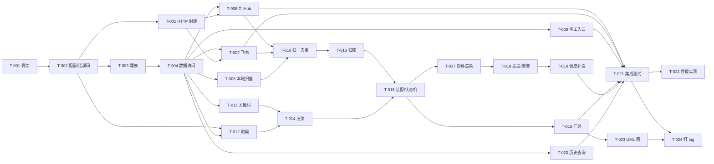

# tasks.md — 智能日报生成器（阶段一 v1 / SDD）

> 元信息
>
> | 项 | 内容 |
> |---|---|
> | 文档版本 | v0.1（初稿，待第 2 周阶段评审） |
> | 上游规范 | `specs/proposal.md` v0.1、`specs/design.md` v0.1 |
> | 覆盖范围 | 阶段一 v1（FR-01～FR-12） |
> | 编写角色 | 架构师（〔待填〕）、开发工程师（〔待填〕） |
> | 更新日期 | 〔待填〕 |

**拆分原则**：一个任务 = 一个可验证的交付物；单任务预估 ≤ 8 人时；每个任务至少对应一条验收标准（CS 编号）。任务描述中不得出现"实现后台""完成采集模块"这类不可验证的表述。

---

## 1. 里程碑与门禁

| 里程碑 | 包含任务 | 门禁条件（全部满足才可进入下一里程碑） |
|---|---|---|
| M0 工程基线 | T-001～T-002 | 空工程可在双环境运行，静态检查与测试命令可用 |
| M1 存储 | T-003～T-004 | 建表幂等、唯一约束生效、数据访问层无裸 SQL 外泄 |
| M2 采集 | T-005～T-010 | 三源采集可独立运行，去重在数据库层生效 |
| M3 生成 | T-011～T-016 | 固定输入可产出符合 CS-01～CS-06 的日报 |
| M4 推送 | T-017～T-020 | dry-run 正文可核对，推送与补发留痕完整 |
| M5 验收 | T-021～T-024 | CS-01～CS-18 全覆盖，集成测试记录归档，可打 tag |

---

## 2. 任务清单

### M0 工程基线

| 编号 | 标题 | 交付物 | 验收标准 | 依赖 | 预估 |
|---|---|---|---|---|---|
| T-001 | 建立工程骨架与工具链 | `pyproject.toml`（uv 管理）、`src/sdr/` 目录树、`tests/`、lint/type/test 命令 | `uv run pytest` 与 `uv run mypy --strict src` 均可执行且通过（0 用例亦视为通过） | — | 3h |
| T-002 | 配置加载与错误码体系 | `config.py`、`errors.py`、`.env.example`（仅键名） | 缺少必需环境变量时退出码 9 并给出变量名；`SDR-E1xx~E5xx` 均有单元测试；`.env.example` 不含任何真实值 | T-001 | 4h |

### M1 存储

| 编号 | 标题 | 交付物 | 验收标准 | 依赖 | 预估 |
|---|---|---|---|---|---|
| T-003 | 建表脚本与约束校验 | `store/schema.py`、`tests/test_schema.py` | 对空库重复执行初始化幂等；插入重复 `dedupe_key` 抛唯一约束异常；`report.status` 非法值被拒 | T-002 | 4h |
| T-004 | 数据访问层 | `store/repo.py`（Event/Report/Entry/SourceLink 的读写接口） | 各实体 CRUD 单测覆盖 ≥ 80%；`src/` 内除 `store/` 外无 `sqlite3` 或 SQL 字符串；事务回滚测试通过 | T-003 | 6h |

### M2 采集

| 编号 | 标题 | 交付物 | 验收标准 | 依赖 | 预估 |
|---|---|---|---|---|---|
| T-005 | HTTP 客户端封装 | `src/sdr/http.py`（超时、重试、日志掩码） | 以 `MockTransport` 模拟超时，重试恰好 3 次且退避为 1/2/4 秒；日志中令牌为掩码（>8 位全部替换） | T-002 | 3h |
| T-006 | GitHub 提交采集器 | `collectors/github.py`、`tests/fixtures/github_commits.json` | 固定 fixture 输入产出预期条数的 `Event`；令牌失效映射 `SDR-E101`、限流映射 `SDR-E102`；不返回部分结果 | T-004、T-005 | 6h |
| T-007 | 飞书任务采集器 | `collectors/feishu.py`、状态映射表 | 任务状态映射逐条断言（完成→done，未知→doing）；授权失败映射 `SDR-E201`；字段缺失映射 `SDR-E202` | T-004、T-005 | 6h |
| T-008 | 本地文件扫描器 | `collectors/local.py` | 仅返回统计窗口内变更的文件；跳过 `.git`、`node_modules`、`.venv`；路径为绝对路径 | T-004 | 3h |
| T-009 | 手工补充入口 | `collectors/manual.py` + `sdr collect --manual` 子参数 | 录入生成 `source=manual` 的 `Event`；空字符串与纯空白被拒绝并提示；单次可录入多条 | T-004 | 3h |
| T-010 | 事件归一与去重 | `collectors/normalize.py` | 同一 commit 采集两次入库仅 1 条（CS-01）；多源同一事件保留主源 `is_primary=1`；去重后顺序按 `occurred_at` 升序 | T-006、T-007、T-008 | 5h |

### M3 生成

| 编号 | 标题 | 交付物 | 验收标准 | 依赖 | 预估 |
|---|---|---|---|---|---|
| T-011 | 关键词规则库与提取器 | `generator/extract.py`、`config/keywords.toml` | 人工标注 ≥ 20 条样本，阶段判定准确率 ≥ 90%；无命中返回 `DOING` 且置信度 0.0（不猜测） | T-004 | 5h |
| T-012 | 时段划分 | `generator/timeline.py`、`config/work_hours.toml` | 落在休息区间的事件归入前一工作时段（IR-05）；时段配置重叠抛 `SDR-E301`；跨时段事件只按开始时间归位一次 | T-002、T-004 | 4h |
| T-013 | 协作归属三级策略 | `generator/attribution.py` | 含 `Co-authored-by` 的多作者提交归属全部标记作者，命中率 100%（CS-03）；无标记时按任务时间窗兜底并加"（协作）"标注；仍无法判定时加 `[待确认]` 前缀 | T-010 | 6h |
| T-014 | 去人称渲染 | `generator/render.py`、`src/sdr/templates/entry.txt` | 输出不含"我/我们/咱"等第一人称，命中数 0（CS-05）；单句 ≤ 60 字；每条附来源链接（CS-04 缺失率 0） | T-011、T-012 | 5h |
| T-015 | 日报装配与状态机 | `generator/report.py` | 请假生成占位条目而非空文件；无事件生成可编辑空白模板（CS-06、CS-14）；`confirmed` 日报不被覆盖，除非 `--force`；一人一日仅一份 | T-013、T-014 | 5h |
| T-016 | 团队汇总 | `generator/summary.py` | 汇总含出勤矩阵、条目计数与状态分布、阻塞项摘要；不含他人明细正文（CS-09）；≥ 2 人固定数据快照测试通过 | T-015 | 5h |

### M4 推送

| 编号 | 标题 | 交付物 | 验收标准 | 依赖 | 预估 |
|---|---|---|---|---|---|
| T-017 | 邮件渲染 | `publisher/mail.py`（渲染部分） | `sdr push --dry-run` 输出正文与 golden 文件逐字一致；纯文本与 HTML 双版本均可生成；主题含日期与成员名 | T-015 | 4h |
| T-018 | SMTP 发送与失败告警 | `publisher/mail.py`（发送部分）、`publisher/alert.py` | 认证失败写 `push_log` 并触发一封告警邮件，标注错误类型（CS-07）；采集失败同样告警且不影响其他源 | T-017 | 4h |
| T-019 | 调度与补发 | `publisher/scheduler.py` | 修改推送时间后下次推送按新时间执行；模拟错过时点，补发在 5 分钟内完成（CS-08）；补发不产生重复邮件 | T-018 | 6h |
| T-020 | 历史查询与权限校验 | `cli history` 实现 | 越权查询返回退出码 8（CS-09）；1000 条数据下查询 ≤ 2 秒（CS-10）；支持 `--from/--to` 区间 | T-004 | 4h |

### M5 验收

| 编号 | 标题 | 交付物 | 验收标准 | 依赖 | 预估 |
|---|---|---|---|---|---|
| T-021 | 端到端集成测试 | `tests/integration/`（固定数据 → 采集 → 生成 → dry-run 推送） | CS-01～CS-18 每条至少一个对应用例，用例与标准编号一一标注；整体覆盖率 ≥ 70%；无网络依赖 | T-006～T-020 | 8h |
| T-022 | 性能实测与指标回填 | `docs/测试记录.md` 中的实测章节 | CS-11（≤ 30 秒）、CS-12（≤ 60 秒）有实测数据与采集环境说明；超限时记录原因与改进项（触发 ADR-001-S） | T-021 | 3h |
| T-023 | UML 正式图与附件 | 用例图、类图、ER 图、泳道图（绘图工具产物）+ `design.md` 附件索引 | 四类图齐全；类图与 `src/` 实际模块一致；泳道图与 ADR 中的时段/归属流程一致 | T-016 | 6h |
| T-024 | v1 交付核对与打 tag | 集成测试记录、规范一致性自查表、tag `v1-sdd` | 全量测试通过；`docs/` 已归档测试记录；`specs/` 与实际实现无偏离（偏离须修订规范而非改实现） | T-021～T-023 | 3h |

**合计预估**：112 人时。按 3 人组第 2 周可用工时（约 3 人 × 5 天 × 6 小时 = 90 人时）计算，总量超出约 24%。削减策略：T-022 与 T-023 可并行压缩至 4h；若仍超限，按 M0→M1→M2→M3→M4 顺序保证主链路完整，T-016（汇总）降级为"仅计数矩阵"。

---

## 3. 依赖图

**关键路径**：T-001 → T-002 → T-003 → T-004 → T-006 → T-010 → T-013 → T-015 → T-017 → T-018 → T-019 → T-021 → T-024（共 62 人时，为第 2 周排期主线）。

**可并行作业**（多人协作依据）：

- 采集组分叉：T-006 与 T-007 在 T-005 完成后可同时进行
- 生成组分叉：T-011 与 T-012 互不依赖，可同时进行
- M3 与 M4 交界：T-016（汇总）与 T-017（邮件渲染）在 T-015 完成后可并行

---

## 4. 任务与验收标准映射

| 验收标准 | 覆盖任务 |
|---|---|
| CS-01 去重准确率 100% | T-003、T-010、T-021 |
| CS-02 时段归位错误率 ≤ 5% | T-012、T-021 |
| CS-03 协作归属命中率 100%（有标记） | T-013、T-021 |
| CS-04 来源链接缺失率 0 | T-014、T-021 |
| CS-05 无第一人称代词 | T-014、T-021 |
| CS-06 请假占位 / 空白模板 | T-015、T-021 |
| CS-07 凭证失效标注 + 告警 | T-002、T-018、T-021 |
| CS-08 时间可配置 + 补发 | T-019、T-021 |
| CS-09 越权访问被拒、汇总不含明细 | T-016、T-020、T-021 |
| CS-10 历史查询可用性与时延 | T-020、T-021 |
| CS-11～CS-13 性能指标 | T-022 |
| CS-14～CS-18 边界场景 | T-015、T-019、T-021 |

> 未映射到任何任务的验收标准 = 规范与任务的偏离，评审前须补齐；反之，任务若不对应任何 CS，则属范围外工作，须从 tasks.md 移除。

---

## 5. 阶段二说明

v2（Superpowers 工作流）的任务清单**不在本文件规划**。理由：指导书要求 v2 以 v1 为对照基线重做，且禁止复制 v1 代码；若在此预先列出 v2 任务，将诱导按 v1 结构照搬，违背阶段二的方法论目的。v2 的 tasks.md 于第 3 周由 `writing-plans` 工作流重新生成，并与本文件并列存放（`specs/tasks.md` → 归档为 `specs/v1/tasks.md`，v2 新建）。

---

## 6. 变更记录

| 版本 | 日期 | 变更内容 | 变更人 |
|---|---|---|---|
| v0.1 | 〔待填〕 | 初稿：24 个任务覆盖 FR-01～FR-12，含里程碑门禁与依赖图 | 〔待填〕 |
