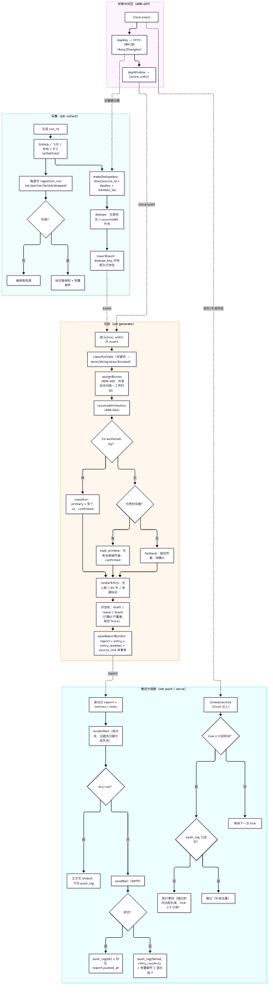
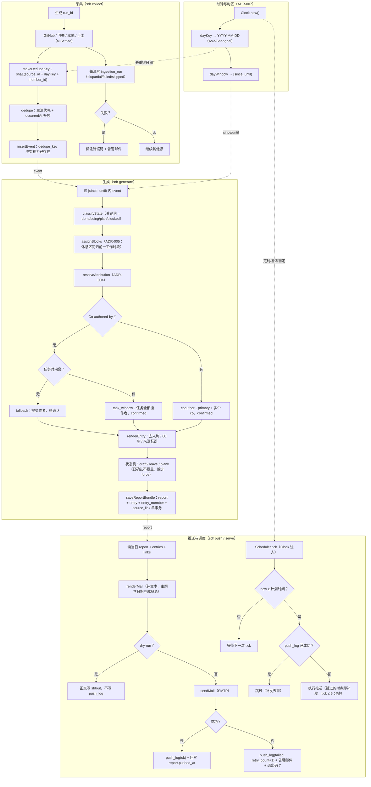

# 泳道图（Mermaid 源文件）

> T-023 交付物：与 ADR-004（归属）、ADR-005（时段）、ADR-007（时钟日界）一致。
> 三条泳道分别对应 `sdr collect` / `sdr generate` / `sdr push|serve`。

> 上图为 泳道图（渲染图），由下方 Mermaid 源码经 mermaid-cli 12.2 渲染（2026-11-26）。

