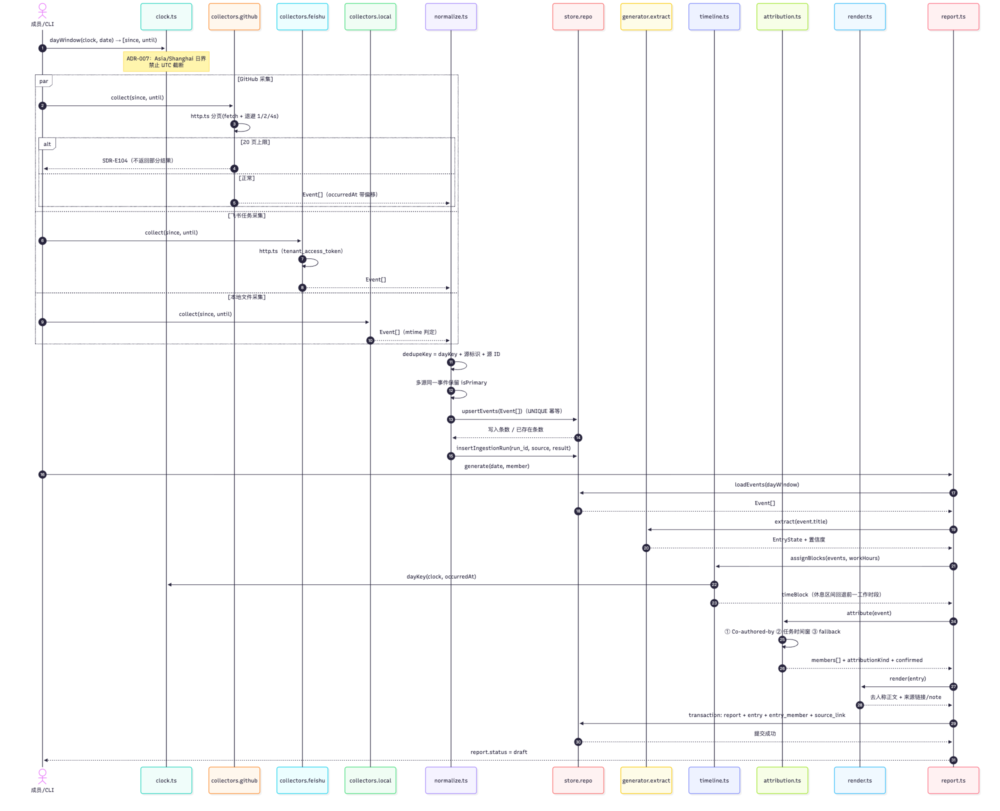
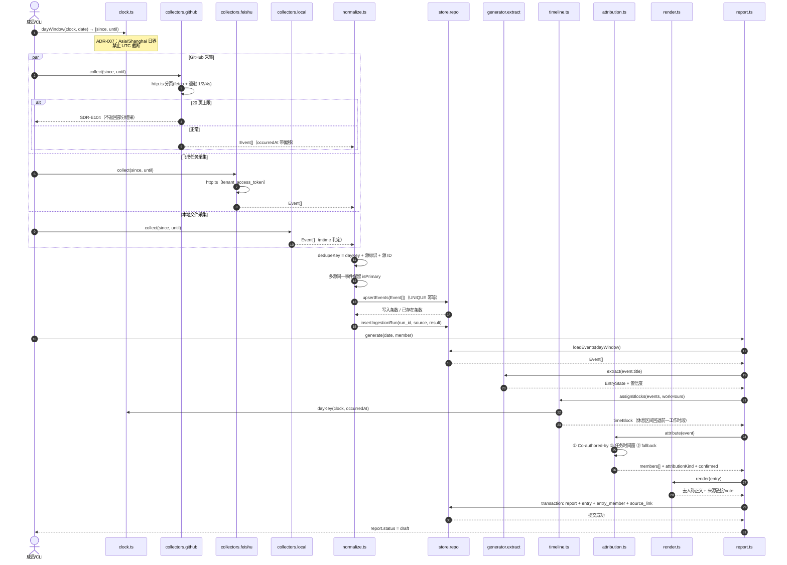

# 序列图：采集 → 生成主流程

> 对应 `sdr collect` → `sdr generate` 两个 CLI 命令，覆盖 design.md §1 数据流步骤 1～3。
> 渲染图见同目录 `05-sequence-generate.png`；本图为 Mermaid 源码，可用 mermaid-cli 复现。

> 上图由下方 Mermaid 源码经 mermaid-cli 12.2 渲染（2026-11-26）。

