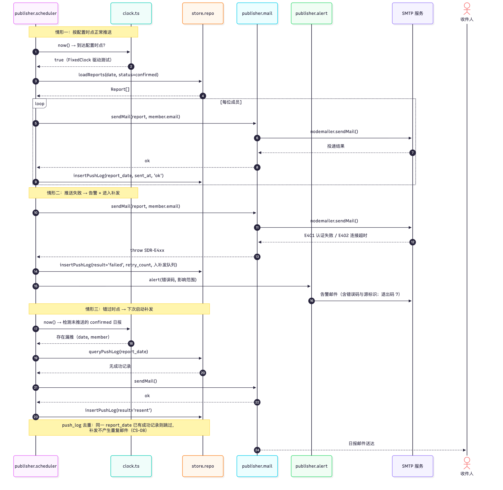
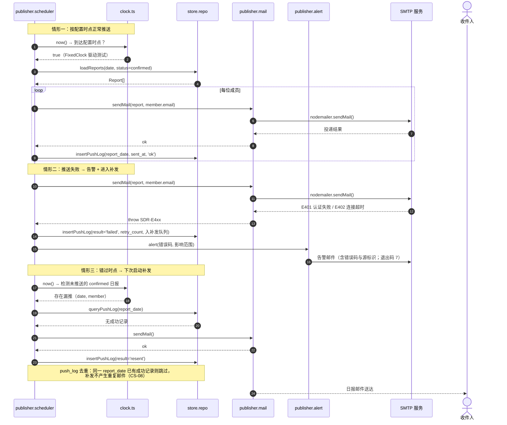

# 序列图：推送、失败告警与补发流程

> 对应 `sdr push` 与 `sdr serve`（调度器），覆盖 design.md §1 数据流步骤 4～5 与 §4 `sendMail` 契约。
> 渲染图见同目录 `06-sequence-push.png`；本图为 Mermaid 源码，可用 mermaid-cli 复现。

> 上图由下方 Mermaid 源码经 mermaid-cli 12.2 渲染（2026-11-26）。

