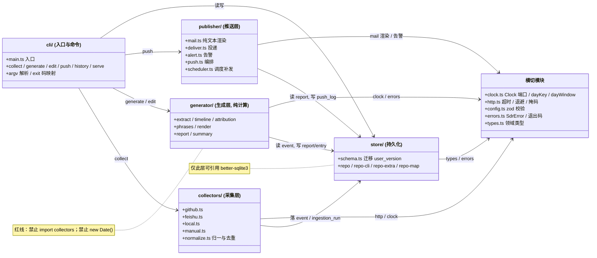

# 阶段二（v2）模块类图 / 依赖图

> 工具绘制：Mermaid（源文件可复现，禁止手绘拍照）。导出 PNG 时用 Mermaid 官方 CLI 或 IDE 插件生成，勿用截图替代。
> 依据：`docs/系统设计报告.docx` §1.4 / §3、`v2/src` 目录结构、`specs/design.md` §2。

## 分层约束（评审检查项）

| 约束 | 校验方式 |
|---|---|
| 生成层不得依赖采集层 | `v2/src/generator` 内无 `collectors` import；ESLint `no-restricted-imports` |
| 仅 `store` 可引用 `better-sqlite3` | ESLint 规则 + code-review 检查项 |
| 业务代码禁止 `new Date()` | 一律经 `Clock` / `dayKey`，ESLint 拦截 |
| 汇总永不 `SELECT entry.content` | `SUMMARY_ROWS_SQL` 白名单 + 白盒用例断言 |
