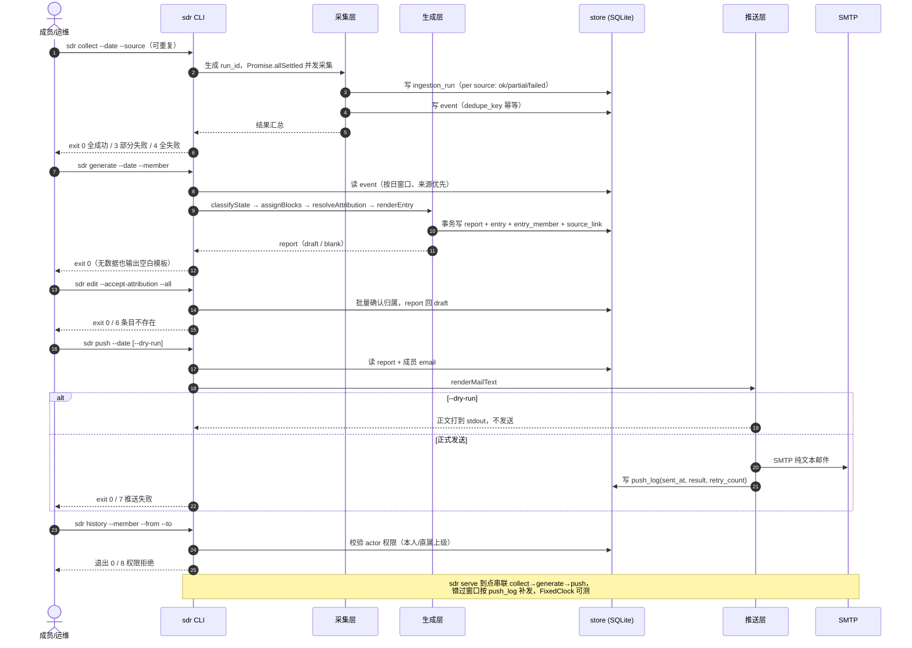

# 阶段二（v2）主链路时序图

> 工具绘制：Mermaid（源文件可复现）。依据 `docs/系统设计报告.docx` §1.4 / §2.4、`specs/design.md` §4.2 与 `v2/src/cli/*.ts` 的实际命令编排。

## 关键契约点（与设计报告一致）

| 节点 | 契约 |
|---|---|
| collect | 每源一条 `ingestion_run`，部分失败不整体回滚（CS-07） |
| generate | 四表同事务写入；无数据 → 空白模板 + exit 0（F-06） |
| edit | 参数互斥（`--all` 不与 `--add-text`/`--remove-entry` 同用） |
| push | `--dry-run` 只渲染；`push_log` 去重保证补发不重发 |
| history | 越权立即失败 exit 8，可见性下沉仓储层 |
