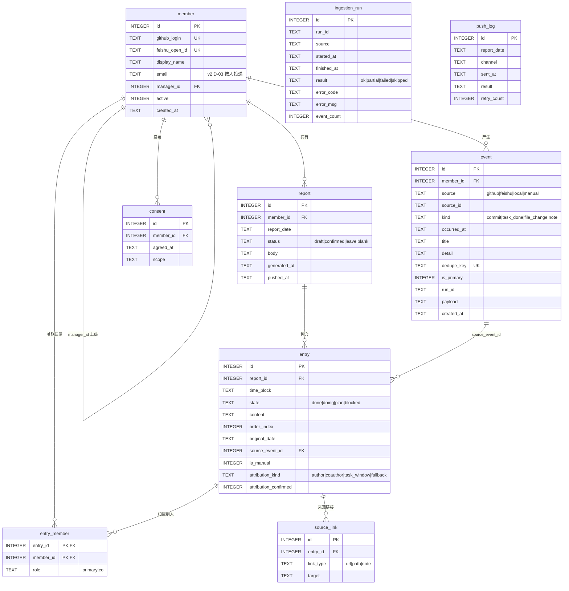

# 阶段二（v2）ER 图（9 表）

> 工具绘制：Mermaid。依据 `v2/src/store/schema.ts` 的 `SCHEMA_V1`（`PRAGMA user_version = 1`）逐表逐列誊写，修改表结构须同步本图与 `specs/design.md` §3.2。

## 约束说明

| 约束 | 落点 |
|---|---|
| `UNIQUE(member_id, report_date)` | 一人一日一份日报，重复生成走 `--force` |
| `dedupe_key UNIQUE` | 跨源去重，天然幂等 |
| `UNIQUE(run_id, source)` | 一次采集每源一条运行记录 |
| `entry_member` 复合主键 | 一条条目可归属多人（ADR-005） |
| CHECK 约束 | 枚举值非法即插入失败，由用例验证 |
| 隐私边界 | `entry.content` 不进入团队汇总投影白名单 |
